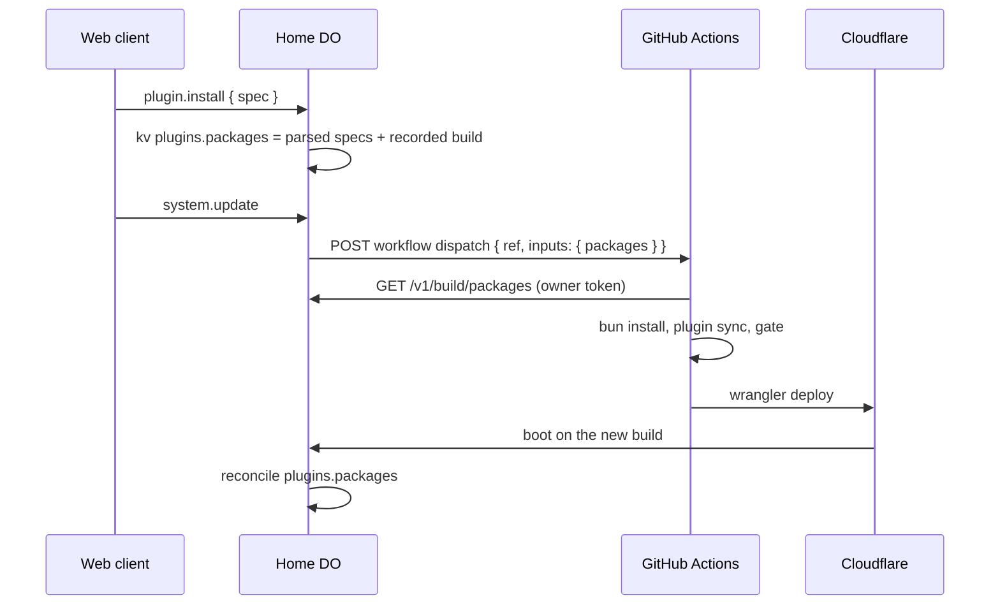

# Installing plugins from the client

A Worker cannot run `bun add` or load code it did not ship with. The client's install button therefore records the owner's wish, and a deploy pipeline turns that wish into a build.



## Record the wish

Owner ops, over the normal command route:

```json
{"id":"install-1","op":"plugin.install","args":{"spec":"xin-plugin-weather@0.2.0"}}
{"id":"install-2","op":"plugin.uninstall","args":{"package":"xin-plugin-time"}}
{"id":"packages-1","op":"plugin.packages","args":{}}
{"id":"update-1","op":"system.update","args":{}}
```

`spec` is parsed at the boundary: a registry name, `name@range`, `github:owner/repo[#ref]`, `git+https://host/x.git[#ref]` or `https://host/x.git[#ref]`. Every other scheme (`file:`, `link:`, `npm:`), a bare tarball URL, whitespace and shell characters are rejected. Installs and uninstalls are idempotent, and an install cancels a pending removal of the same package. Uninstalling a package that provides a core row, one that is local to this repository (`plugins/*`), or one that is not in the build is rejected; disable a local package's bundle instead.

`plugin.packages` reports the build's `installed` packages and the `pending` list:

```json
{
  "installed": [{ "package": "xin", "version": "dev" }, { "package": "xin-plugin-files", "version": "0.1.0" }],
  "pending": { "add": ["xin-plugin-weather@0.2.0"], "remove": ["xin-plugin-time"] }
}
```

## Point the deploy hook at the workflow

`deploy-hook` POSTs `{ "ref": "<ref>", "inputs": { "packages": "{\"add\":[...],\"remove\":[...]}" } }` to its `url` config. `workflow_dispatch` accepts `inputs` only as a map of strings, so the list is serialised once into the `packages` input. The row's config is set with `plugin.configure`, and any secret in it is a named credential written with `secret.set` and referenced as `${credential:REF}`:

```json
{"id":"s1","op":"secret.set","args":{"ref":"deploy-hook.token","value":"<GitHub token with actions:write>"}}
{"id":"s2","op":"plugin.configure","args":{"id":"deploy-hook","config":{"url":"https://api.github.com/repos/<owner>/<repo>/actions/workflows/install.yml/dispatches","token":"${credential:deploy-hook.token}","ref":"main"}}}
```

The dispatch endpoint takes `{ "ref", "inputs" }`, and its `inputs.packages` value is the JSON list. The workflow therefore starts from that input, and falls back to fetching the list from the Worker when the input is empty.

## Repository secrets

| Secret | Use |
| --- | --- |
| `CLOUDFLARE_API_TOKEN` | Workers Scripts:Edit, to run `wrangler deploy` |
| `CLOUDFLARE_ACCOUNT_ID` | the account that owns the Worker |
| `XIN_BASE_URL` | the Worker origin, for example `https://xin.example.workers.dev` |
| `XIN_OWNER_TOKEN` | the same value as the Worker's `OWNER_TOKEN`, to read `/v1/build/packages` |

## Workflow

Add this as `.github/workflows/install.yml` in the repository that deploys Xin. It is not created by this repo.

```yaml
name: install

on:
  workflow_dispatch:
    inputs:
      packages:
        description: '{"add":[],"remove":[]} to apply instead of the stored list'
        required: false
        type: string

permissions:
  contents: read

concurrency:
  group: install
  cancel-in-progress: false

jobs:
  deploy:
    runs-on: ubuntu-latest
    timeout-minutes: 30
    steps:
      - uses: actions/checkout@v4

      - uses: oven-sh/setup-bun@v2
        with:
          bun-version: latest

      - name: Install dependencies
        run: bun install --frozen-lockfile

      - name: Fetch pending packages
        env:
          XIN_BASE_URL: ${{ secrets.XIN_BASE_URL }}
          XIN_OWNER_TOKEN: ${{ secrets.XIN_OWNER_TOKEN }}
          INPUT_PACKAGES: ${{ inputs.packages }}
        run: |
          set -euo pipefail
          if [ -n "${INPUT_PACKAGES}" ]; then
            printf '%s' "${INPUT_PACKAGES}" > packages.json
          else
            curl -fsS -H "authorization: Bearer ${XIN_OWNER_TOKEN}" \
              "${XIN_BASE_URL}/v1/build/packages" > packages.json
          fi
          jq -e '(.add | type) == "array" and (.remove | type) == "array"' packages.json > /dev/null

      - name: Apply packages
        run: |
          set -euo pipefail
          if jq -e '(.add | length) == 0 and (.remove | length) == 0' packages.json > /dev/null; then
            echo "no pending packages"
            exit 0
          fi
          bun scripts/xin.ts plugin sync packages.json

      - name: Gate
        run: bun scripts/gate.ts run fmt lint types test bundle

      - name: Deploy
        env:
          CLOUDFLARE_API_TOKEN: ${{ secrets.CLOUDFLARE_API_TOKEN }}
          CLOUDFLARE_ACCOUNT_ID: ${{ secrets.CLOUDFLARE_ACCOUNT_ID }}
        run: bunx wrangler deploy --define XIN_BUILD:"${{ github.sha }}"
```

`plugin sync` runs `bun add` and `bun remove`, then enables each new package's bundle in `xin.profile.json` and regenerates `src/catalog.gen.ts`. Every `bun` command runs before the profile changes, so a failed removal leaves both files untouched. With an empty list it prints `plugin sync: nothing to do` and changes nothing, so a dispatch after the wish was already reconciled is a no-op.

When a later build boots, the `packages` row clears pending entries that build satisfies. An entry recorded under the running build is kept, so an eviction never drops a wish before a deploy. On a newer build, a registry add is done when the package name is in the catalog sources and, when the spec gives a range, the built version satisfies it; a git add is done when its resolved package name is present, or, without one, once the build changed; a removal is done when the package is gone. Reconcile is idempotent, so a crash or a second dispatch is harmless.

## Notes

- The workflow deploys the tree it built, not the tree it checked out: `bun.lock`, `src/catalog.gen.ts` and `xin.profile.json` change inside the job. Commit the regenerated files back to the deployed branch if the repository must match the running build; otherwise every dispatch resolves the specs again.
- `bun scripts/gate.ts run` starts its own runner on the GitHub runner. It serializes the heavy steps on that machine; no box pool is needed.
- Never put the deploy token, the owner token or the Cloudflare token in a command, a log line or the repository. The secret values above live only in GitHub and in the sealed credentials table behind `secret.set`; the deploy-hook row holds only the `${credential:…}` template.
