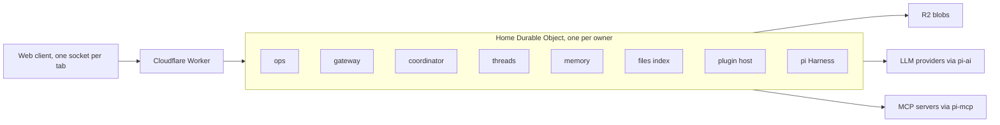

# Xin

Design v2, 6 November 2026.

Xin is a personal agent: a Cloudflare Worker in front of one Home Durable Object per owner, with file bytes in R2. It is built on pi-durable, pi-ai and pi-mcp 1.5.0, and exposes Projects, Spaces, Puck and threads. The client is web-only. Xin works with files only and executes no code. No model is hard-coded: the catalog, the credentials and the per-conversation choice all come from the user's configuration at run time.

## Key invariants

- **Arm the alarm before any call that can start work.** An early alarm is harmless. A missing alarm strands work forever (§1).
- **Anything that must change atomically with a transcript is a pi document.** Anything outside pi's commit (the claim before submit, FTS, file index, secrets) is a host table, written through the same `DurableObjectSqliteDatabase`, so host and pi calls share one operation queue and never interleave inside a pi transaction (§2).
- **There are no model ids in Xin's code.** The catalog comes from pi-ai at run time, the credentials are the user's, and the choice is stored in each conversation's `pi.agent`. A switch takes effect at the next model request, so it can land inside a run that is already going (§7).
- **A child receives only its brief and role, never the parent's history.** Briefs have to be self-contained, threads start cheap and focused, and nothing private leaks into a thread by accident (§8).
- **The host picks the dispatch mode deterministically from `pi.live`.** The LLM is never asked (§6).
- **Files only, no code execution.** `exec()` returns `not_supported`, so pi's bash is simply not installed (§14).

## System

## Index

- [01 Host](./architecture/01-host.md): the Home DO host loop, alarm arming, runtime limits.
- [02 State](./architecture/02-state.md): pi documents versus host tables, IDs and idempotency keys.
- [03 Commands and wire](./architecture/03-commands-and-wire.md): the shared `ops` layer and the web wire protocol.
- [04 Intake and dispatch](./architecture/04-intake-and-dispatch.md): the inbound debounce, batch claim, and the four dispatch modes.
- [05 Models](./architecture/05-models.md): runtime model resolution, switching mid-run, the `set_model` tool, credentials.
- [06 Orchestration](./architecture/06-orchestration.md): orchestrator tools, thread lifecycle, jobs, questions, watchdog.
- [07 Memory](./architecture/07-memory.md): append-only notes and the single Dreamer writer.
- [08 Files](./architecture/08-files.md): `R2Env`, pi's file tools, uploads, content-addressed blobs.
- [09 Plugins](./architecture/09-plugins.md): plugin manifest, reconcile lifecycle, host facade, MCP, trust.
- [10 Time](./architecture/10-time.md): schedules as pi tasks and the single owned timer.
- [11 Failures and cost](./architecture/11-failures-and-cost.md): the failure matrix and the DO row-cost model.
- [12 Market](./architecture/12-market.md): runtime bundles, contribution rows, discovery and updates on the free plan.
- [13 Always-on](./architecture/13-always-on.md): the ambient clock, manual compaction, the loop guard, scheduled tasks and goals.
- [Provenance](./provenance.md): what came from pi-durable, pi-ai, t3code, kiko and the other sources.
- [Milestones](./milestones.md): build order, each with its proof, dependencies and parallel work.
