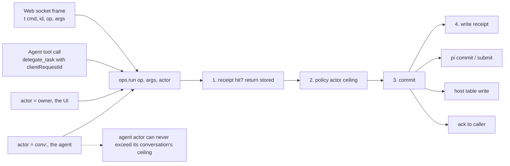

# 3–4 · Commands and the wire protocol

This section decides that every mutation is one `op` shared by the web socket and the coordinator's tools, and defines the web wire protocol that carries those commands.

Read with: [01 Host](./01-host.md) for the event handlers, [02 State](./02-state.md) for the tables an op writes, [04 Intake and dispatch](./04-intake-and-dispatch.md) for what happens after a command lands, [06 Orchestration](./06-orchestration.md) for the tools built on the same ops.

## 3 · One command layer for the UI and the agent

This is ported from t3's `ThreadManagementService`. Every mutation is an `op` in `src/ops.ts`. The web socket handler and the coordinator's tools are both thin adapters over the same function, so what the agent can do and what you can do in the UI can never drift apart.



The op set:

```text
ops: message.send · message.withdraw · conv.configure(model, thinking) · conv.stop
     project.create/update/archive · space.create/update/archive · thread.create · thread.archive · thread.send(mode) · thread.stop · thread.rename
     puck.create/rename/archive · puck.list · artifact.list/read/write/delete
     request.respond · file.put/read/revision/revisions/delete · memory.add/forget/pin/edit/dismiss · plugin.enable/configure · credential.set
reads (owner): conv.context(conv?) · history.page(conversationId, before?, limit?) · request.list(limit?, projectId?) · job.list(limit?)
               usage.summary · usage.cap · usage.cap.set(usd?, clear?) · usage.alert · usage.alert.set(usd)
               notify.prefs · notify.set(waiting?, finished?, failed?, spend?, schedule?) · notify.quiet · notify.quiet.set(enabled?, start?, end?)
               push.list · push.test · owner.read · owner.set(name?, instructions?)
               session.list · session.close(id?) · session.rotate
               system.logs · skill.read(name) · mcp.tools(name) · mcp.resources(name) · mcp.prompts(name) · memory.profile.write(markdown) · memory.suggested(conversationId, scope?) · prompt.list(conversation?) / prompt.put / prompt.delete
                market.policy · market.policy.set(autoUpdate) · market.refresh · market.skip/unskip/skipped · market.rollback
```

Reads take the same path, so the Inbox, the transcript and the Usage pane see exactly the state the agent's tools see. `request.list` returns every open `xin.requests` entry in active projects, newest first and bounded by `limit` (default 50, max 200). `history.page` pages the same entry projection the conversation snapshot carries, taking the snapshot's `before` entry id as an inclusive cursor (the first entry the client is missing) and returning entries oldest first plus `nextBefore` while older entries remain. `usage.summary` reports pi's `pi.usage` ledger as `spend` and `tokens` totals plus `today` and `month` `{spend, tokens}` buckets from `usage_daily`, a `days` array of `{day, spend, tokens}` for the current and previous month, `cap` (the owner's monthly cap in USD, or null) and `alert` (the daily alert in USD), plus `byModel`, `byTool` and `byProject` slices (per-model slices carry `provider`, `modelId`, `input`, `output`, `cacheRead`, `cacheWrite`, `totalTokens`, `cost`; per-project slices carry `id`, `name`, `spend`, `tokens`, summed from each project's coordinator and thread `pi.usage`). The cap is enforced, not just displayed: `message.send` answers `forbidden` while the month's spend is at or above it. Crossing the daily alert, 80% of the cap and the cap itself records one mark each (per day, per month level) and pushes a `spend` notification, which `notify.set` can switch off.

`owner.read` returns the stored `{name, instructions}` (empty strings when unset); `owner.set` trims and stores either field, and the instructions render as the system-prompt section `<owner>` for every conversation.

`session.list` returns one entry per live socket — `{id, since, origin}` — and `session.close` closes the socket with that `id`, or every live socket when the id is omitted, returning `{closed}`. A socket is the only session state; the owner token is the identity, so `session.rotate` is the revocation path: it mints a new `own_`-prefixed token, stores only its SHA-256 in `kv` under `owner.token`, closes every socket, and returns `{token}` for the one moment it is readable. The home is the auth boundary: `Home.fetch` accepts the deploy token (`OWNER_TOKEN`) or the token whose digest matches `owner.token`, on every route including `/v1/repair`, and answers 401 otherwise. The digest is read from `kv` once per instance (through the raw storage, so a home that failed to boot still knows it) and held in memory; `session.rotate` replaces the held digest in the step that writes it, so a rotation takes effect on the next request. The Worker answers 401 itself only for a request with no bearer, and forwards the rest unchecked, so a rotated-token request costs one home request and no row read. `PUT /files` is the exception: it writes R2 before the home sees it, so the Worker compares the deploy token or asks the home through `POST /v1/auth` (204 or 401, carrying the bearer) before storing a byte, and the commit it then sends carries the same bearer. The deploy token always works; it is the recovery credential.

An op declared with `receipts: false` skips steps 1 and 4 entirely: its own state answers a resend, so no receipt is read, written or swept. Only `message.send` does this, because its intake item carries the command id (02). Every other op keeps a receipt.

Receipts store `ok` and deterministic rejections (`unknown_op`, `bad_args`, `forbidden`). A `failed` outcome (the op threw) stores none, so a retry runs it again. The op's effect and its receipt are separate writes, so every op must also be idempotent through its derived key. The same command layer is reachable over HTTP as `POST /v1/cmd {id, op, args?}`, and an omitted `args` means `{}`. Concurrent duplicates inside one object share one in-flight run. The body may also be an array of 1 to 32 such frames: they run in order, each with its own receipt, and the answer is the array of acks in the same order, so one Worker request and one home request carry them all. An empty, oversized or malformed batch is refused with 400 before any of it runs. A frame that throws outside its op's own outcome (an `ops/before` hook, a receipt write, the sweep) gets its own `failed` ack and stores no receipt; every later frame in that batch is answered `{ok:false, error:{code:"not_run"}}` and never runs, while frames before it keep their acks.

A frame may carry `read: true`, the client's statement that the op changes nothing. The home keeps a revision in memory: a per-instance random epoch plus a counter, so an eviction never repeats a value. Every batch holding a frame without `read` bumps it, returns it in the `x-ingle-rev` response header, and pushes `{t:"changed", stream:"home", rev}` to every home subscriber. That costs 0 rows and 0 requests, and one frame of under 80 B per mutating batch per open home socket. The socket `cmd` frame does not bump it, since the web client does not send commands over the socket.

The web client batches every op issued in the same task and classifies the reads in one table in `web/src/lib/api.ts`. A `cached` read (lists and settings that only a command changes) is answered from a per-op, per-args cache for at most 60 s; concurrent callers share one request. A `live` read (sessions, metrics, usage, logs, files, Drive entries, history, requests, jobs) is batched but never cached. Neither drops the cache. Any other op does, once it settles with any outcome, since a failed batch may still have committed. The cache is also dropped by a home `snap`, by a `changed` frame whose revision this tab has not seen (its own `x-ingle-rev` marks its own change as seen), and whenever a socket opens, because `changed` frames sent while it was down never arrived. The 60 s TTL is the backstop for changes no command announces, such as an agent's tool writes or a market auto-update.

## 4 · Web wire protocol (one socket per tab, hibernation-safe)

```text
client → {t:"cmd",  id, op, args, read?}             id = client UUID, retried verbatim on reconnect; read: the op changes nothing
client → {t:"sub",  stream:"home"|"conv:<id>"}       stream subscription
client → {t:"typing", conv, on}                       not stored; extends debounce (§5)
client → {"_tag":"Ping"}                              auto-answered by the runtime: idle tabs never wake the DO

server → {t:"hello", socket}                          the socket's own id, sent once on accept
server → {t:"ack",  id, ok, result|error}
server → {t:"snap", stream, value, rev?}              bounded: last 60 entries + live state; older via cmd history.page; home carries rev
server → {t:"resume", stream, value?, start?}         answer to a sub with resume: what the client lacks (below)
server → {t:"ev",   stream, events[]}                 pi watchEvents deltas: text appends, tool output, status
server → {t:"changed", stream:"home", rev}          a mutating /v1/cmd batch committed somewhere: drop cached reads (§3)
```

- `hello` is what lets a client recognise its own row in `session.list` without guessing from the origin; a browser behind one host otherwise looks like every other browser on it.

- Sockets use `ctx.acceptWebSocket()`. Each socket's subscriptions live in `serializeAttachment()`, so they survive hibernation.
- There is **one pi conversation watch per subscribed conversation** (`Conversation.watch`, a window of 60 to 120 entries), shared by all sockets. It starts on the first `sub`, and again on wake for every stream in the surviving sockets' attachments, so a hibernated tab keeps getting events. It stops when the last subscriber leaves. `ev.events` are the watch's delta ops against the snapshot's view.
- **Reconnect resumes from what the client holds.** A resubscribe may carry `resume`. For a conversation that is `{start, from}`: the oldest entry id the client holds, and one past its newest. When `start` is at or before the first entry of the shared watch's window, the server answers `{t:"resume", value, start}`. `value` is the watch's current view with only the entries from `from` on, and `start` is the window's first entry id. The client keeps its own entries from `start` up to `from`, then appends `value.entries`, which rebuilds exactly the window that later `ev` ops index into. For the home stream, `resume` is `{rev}`, the digest the last `snap` carried. When that digest is still current, the answer is `{t:"resume", stream}` with no value. Any other case falls back to a full `snap`. There is no sequence log: the cursor is entry ids, which never change once committed. A `snap` and a resume both start from the watch's newest value, not its value at attachment. Only the subscribers a resume cursor was computed from apply its answer; every other subscriber of the stream, including one that joins while the resume is in flight, sends its own plain `sub` and takes the `snap`. A server from before resume answers a `sub` carrying one with `error: unknown frame`, and the client then resends plain `sub`s for the streams it was resuming.
- **Loading earlier entries** is one read op, not a replay: the snapshot value carries `before`, the entry just older than its window, and `history.page` passes it back as an exclusive cursor. The client prepends each page and keeps the newest `nextBefore` until a page omits it.
- The `home` stream is a projection: projects, each project's Overview (threads grouped by status), the open-request count, and running jobs. It is recomputed from docs on every commit that touches `xin.*` docs, then diffed and sent.
- When no socket is connected and a report or question lands, the DO sends one Web Push (VAPID, sent with `fetch`) carrying the thread title.
