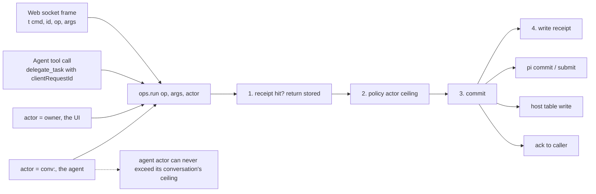

# 3–4 · Commands and the wire protocol

This section decides that every mutation is one `op` shared by the web socket and the coordinator's tools, and defines the web wire protocol that carries those commands.

Read with: [01 Host](./01-host.md) for the event handlers, [02 State](./02-state.md) for the tables an op writes, [04 Intake and dispatch](./04-intake-and-dispatch.md) for what happens after a command lands, [06 Orchestration](./06-orchestration.md) for the tools built on the same ops.

## 3 · One command layer for the UI and the agent

This is ported from t3's `ThreadManagementService`. Every mutation is an `op` in `src/ops.ts`. The web socket handler and the coordinator's tools are both thin adapters over the same function, so what the agent can do and what you can do in the UI can never drift apart.



The op set:

```text
ops: message.send · message.withdraw · conv.configure(model, thinking) · conv.stop
     project.create/update/archive · thread.send(mode) · thread.stop · thread.rename
     request.respond · file.put/delete · memory.forget · plugin.enable/configure · credential.set
```

## 4 · Web wire protocol (one socket per tab, hibernation-safe)

```text
client → {t:"cmd",  id, op, args}                    id = client UUID, retried verbatim on reconnect
client → {t:"sub",  stream:"home"|"conv:<id>"}       stream subscription
client → {t:"typing", conv, on}                       not stored; extends debounce (§5)
client → {"_tag":"Ping"}                              auto-answered by the runtime: idle tabs never wake the DO

server → {t:"ack",  id, ok, result|error}
server → {t:"snap", stream, value}                    bounded: last 60 entries + live state; older via cmd history.page
server → {t:"ev",   stream, events[]}                 pi watchEvents deltas: text appends, tool output, status
```

- Sockets use `ctx.acceptWebSocket()`. Each socket's subscriptions live in `serializeAttachment()`, so they survive hibernation.
- There is **one pi `watchEvents` per subscribed conversation**, shared by all sockets, started lazily on the first `sub` after a wake and stopped when the last subscriber leaves.
- **Reconnect = fresh snapshot.** pi doesn't replay, and that's fine: the snapshot is bounded and the client keeps its own cache. Cursor replay (kiko and t3) adds a sequence log we don't need.
- The `home` stream is a projection: projects, each project's Overview (threads grouped by status), the open-request count, and running jobs. It is recomputed from docs on every commit that touches `xin.*` docs, then diffed and sent.
- When no socket is connected and a report or question lands, the DO sends one Web Push (VAPID, sent with `fetch`) carrying the thread title.
