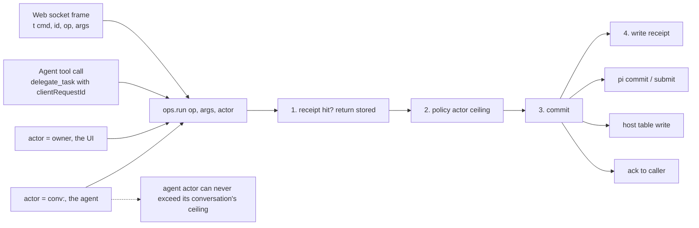

# 3–4 · Commands and the wire protocol

This section decides that every mutation is one `op` shared by the web socket and the coordinator's tools, and defines the web wire protocol that carries those commands.

Read with: [01 Host](./01-host.md) for the event handlers, [02 State](./02-state.md) for the tables an op writes, [04 Intake and dispatch](./04-intake-and-dispatch.md) for what happens after a command lands, [06 Orchestration](./06-orchestration.md) for the tools built on the same ops.

## 3 · One command layer for the UI and the agent

This is ported from t3's `ThreadManagementService`. Every mutation is an `op` in `src/ops.ts`. The web socket handler and the coordinator's tools are both thin adapters over the same function, so what the agent can do and what you can do in the UI can never drift apart.



The op set:

```text
ops: message.send · message.withdraw · conv.configure(model, thinking) · conv.stop
     project.create/update/archive · thread.send(mode) · thread.stop · thread.rename
     request.respond · file.put/read/revision/revisions/delete · memory.add/forget/pin/edit · plugin.enable/configure · credential.set
reads (owner): history.page(conversationId, before?, limit?) · request.list(limit?, projectId?) · job.list(limit?)
               usage.summary · usage.cap · usage.cap.set(usd?, clear?) · usage.alert · usage.alert.set(usd)
               notify.prefs · notify.set(waiting?, finished?, failed?, spend?, schedule?) · notify.quiet · notify.quiet.set(enabled?, start?, end?)
               push.list · push.test · owner.read · owner.set(name?, instructions?)
               session.list · session.close(id?) · session.rotate
               system.logs · skill.read(name) · mcp.tools(name) · memory.profile.write(markdown) · prompt.list/put/delete
               market.policy · market.policy.set(autoUpdate) · market.refresh · market.skip/unskip/skipped · market.rollback
```

Reads take the same path, so the Inbox, the transcript and the Usage pane see exactly the state the agent's tools see. `request.list` returns every open `xin.requests` entry in active projects, newest first and bounded by `limit` (default 50, max 200). `history.page` pages the same entry projection the conversation snapshot carries, taking the snapshot's `before` entry id as an inclusive cursor (the first entry the client is missing) and returning entries oldest first plus `nextBefore` while older entries remain. `usage.summary` reports pi's `pi.usage` ledger as `spend` and `tokens` totals plus `today` and `month` `{spend, tokens}` buckets from `usage_daily`, a `days` array of `{day, spend, tokens}` for the current and previous month, `cap` (the owner's monthly cap in USD, or null) and `alert` (the daily alert in USD), plus `byModel`, `byTool` and `byProject` slices (per-model slices carry `provider`, `modelId`, `input`, `output`, `cacheRead`, `cacheWrite`, `totalTokens`, `cost`; per-project slices carry `id`, `name`, `spend`, `tokens`, summed from each project's coordinator and thread `pi.usage`). The cap is enforced, not just displayed: `message.send` answers `forbidden` while the month's spend is at or above it. Crossing the daily alert, 80% of the cap and the cap itself records one mark each (per day, per month level) and pushes a `spend` notification, which `notify.set` can switch off.

`owner.read` returns the stored `{name, instructions}` (empty strings when unset); `owner.set` trims and stores either field, and the instructions render as the system-prompt section `<owner>` for every conversation.

`session.list` returns one entry per live socket — `{id, since, origin}` — and `session.close` closes the socket with that `id`, or every live socket when the id is omitted, returning `{closed}`. A socket is the only session state; the owner token is the identity, so `session.rotate` is the revocation path: it mints a new `own_`-prefixed token, stores only its SHA-256 in `kv` under `owner.token`, closes every socket, and returns `{token}` for the one moment it is readable. The Worker accepts the deploy token (`OWNER_TOKEN`) or any token whose digest the home matches, asking the home through `POST /v1/auth {token}` (204 or 401) only when the deploy token does not match, so a rotation takes effect on the next request. The deploy token always works; it is the recovery credential.

Receipts store `ok` and deterministic rejections (`unknown_op`, `bad_args`, `forbidden`). A `failed` outcome (the op threw) stores none, so a retry runs it again. The op's effect and its receipt are separate writes, so every op must also be idempotent through its derived key. The same command layer is reachable over HTTP as `POST /v1/cmd {id, op, args?}`, and an omitted `args` means `{}`. Concurrent duplicates inside one object share one in-flight run.

## 4 · Web wire protocol (one socket per tab, hibernation-safe)

```text
client → {t:"cmd",  id, op, args}                    id = client UUID, retried verbatim on reconnect
client → {t:"sub",  stream:"home"|"conv:<id>"}       stream subscription
client → {t:"typing", conv, on}                       not stored; extends debounce (§5)
client → {"_tag":"Ping"}                              auto-answered by the runtime: idle tabs never wake the DO

server → {t:"hello", socket}                          the socket's own id, sent once on accept
server → {t:"ack",  id, ok, result|error}
server → {t:"snap", stream, value}                    bounded: last 60 entries + live state; older via cmd history.page
server → {t:"ev",   stream, events[]}                 pi watchEvents deltas: text appends, tool output, status
```

- `hello` is what lets a client recognise its own row in `session.list` without guessing from the origin; a browser behind one host otherwise looks like every other browser on it.

- Sockets use `ctx.acceptWebSocket()`. Each socket's subscriptions live in `serializeAttachment()`, so they survive hibernation.
- There is **one pi conversation watch per subscribed conversation** (`Conversation.watch`, a window of 60 to 120 entries), shared by all sockets. It starts on the first `sub`, and again on wake for every stream in the surviving sockets' attachments, so a hibernated tab keeps getting events. It stops when the last subscriber leaves. `ev.events` are the watch's delta ops against the snapshot's view.
- **Reconnect = fresh snapshot.** pi doesn't replay, and that's fine: the snapshot is bounded and the client keeps its own cache. Cursor replay (kiko and t3) adds a sequence log we don't need.
- **Loading earlier entries** is one read op, not a replay: the snapshot value carries `before`, the entry just older than its window, and `history.page` passes it back as an exclusive cursor. The client prepends each page and keeps the newest `nextBefore` until a page omits it.
- The `home` stream is a projection: projects, each project's Overview (threads grouped by status), the open-request count, and running jobs. It is recomputed from docs on every commit that touches `xin.*` docs, then diffed and sent.
- When no socket is connected and a report or question lands, the DO sends one Web Push (VAPID, sent with `fetch`) carrying the thread title.
