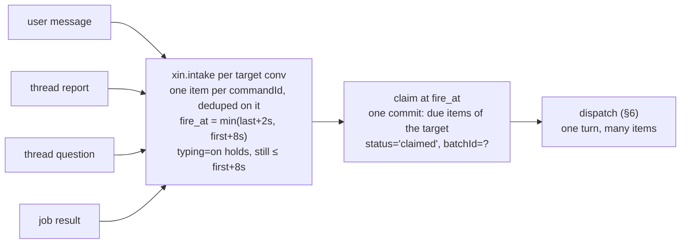
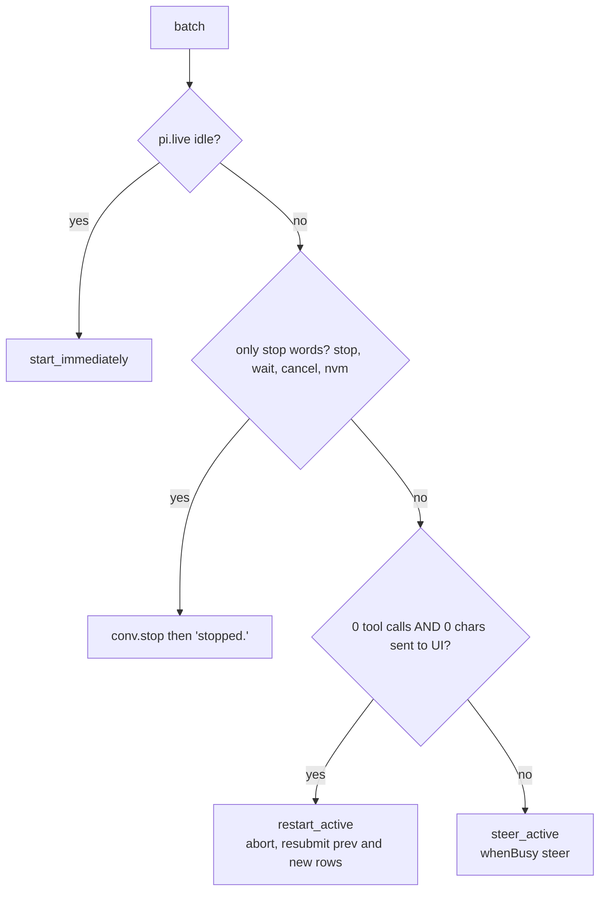

# 5–6 · Intake and dispatch

This section decides how inbound items are debounced and claimed as one batch, and how the host deterministically picks a dispatch mode for that batch.

Read with: [02 State](./02-state.md) for the `xin.intake` document, [03 Commands and wire](./03-commands-and-wire.md) for the command layer, [06 Orchestration](./06-orchestration.md) for the coordinator turn a batch feeds, [10 Time](./10-time.md) for the only timer Ingle owns, [11 Failures and cost](./11-failures-and-cost.md) for the crash cases.

## 5 · Intake: answer the burst



The queue is one session document, `xin.intake` (§02), not a host table: `enqueue`, the claim, a listener's body rewrite and `markDone` are each one commit, so each costs one journal row instead of a table row plus its index rows. Reports use the same pipe: 8 threads finishing within 2 s cost ONE coordinator turn, not 8. A question answered in the UI before its item is claimed withdraws it (t3 rule: no stale notification turns).

**Rendering a batch.** The batch becomes one `submit({type:"input", content, entry:{kind:"xin.batch", data:rows}, requestId:"batch:"+id})`. The UI renders `xin.batch` as the original bubbles. The model sees one user message with items ordered by `clientTs`:

```text
<msg t="16:31:50">so like</msg>
<msg t="16:31:51">https://…</msg>
<msg t="16:31:52">can u setup</msg>
<thread id="th_7" title="Book ryokan" status="completed">Booked Kinosaki, ¥38k, free cancel to 20 Nov</thread>
```

**Attachments.** A user item may carry up to 12 files already stored through `PUT /files/<path>`. `message.send` stats each path once (`files.stat`, one index row per file) and refuses a file the index does not hold with `bad_args`; the item then records, per file, the client's `name` and the index's `path`, `type`, `size` and `sha256`. The client's own size and type are never trusted. That stored record is what the transcript's `xin.batch` entry and a retry carry, so rendering a turn reads no index rows: `plugins/intake/attachments.ts` reads bytes by content address (`files.readBlob`, one R2 get), which also makes a replay after a crash render the same turn even if the path was overwritten since. It appends one block after the messages:

```text
<attachments>
- diagram.png (image/png, 1 204 912 bytes) at /projects/launch/attachments/diagram.png: shown below
- photo.png (image/png, 80 112 bytes) at /projects/launch/attachments/photo.png: not shown, this model does not take images
- brief.txt (text/plain, 5 120 bytes) at /projects/launch/attachments/brief.txt: inlined below
- deck.pdf (application/pdf, 2 048 000 bytes) at /projects/launch/attachments/deck.pdf
</attachments>
<file path="/projects/launch/attachments/brief.txt">
…
</file>
```

- **Images** (PNG, JPEG, GIF, WebP) go as `image` parts, base64, only when the conversation's model lists `image` in its pi-ai catalog `input`; a text-only model gets the note instead and no bytes are read. All images share one `IMAGE_BUDGET_BYTES` (1 MiB) per turn.
- **Text-like files** (`text/*`, JSON, XML, SVG: the `isText` types `file.read` previews) are inlined as `<file>` blocks within one `TEXT_BUDGET_BYTES` (64 KiB) per turn; a file over what is left is listed as `not inlined` and the model reads it with its own tools.
- **Any other file** is the reference line alone.
- A recorded blob R2 no longer holds is listed as `no longer stored`.
- An item queued before `message.send` recorded blobs (no `sha256`) keeps its files and lists them by path alone.
- Nothing a file brings can forge the markup: names, types and paths are escaped (`&`, `<`, `>`, control characters and line or paragraph separators (U+2028, U+2029) and bidi controls (`\p{Bidi_Control}`, so `invoice\u202Efdp.exe` cannot read as a PDF) folded to spaces; other format characters such as an emoji's zero-width joiner are kept, and `"` in the path attribute), an inlined file's own `<file`, `</file`, `<attachments` and `</attachments` tags are escaped, and an image whose bytes do not start with its type's signature is listed as `not shown, its bytes are not image/png` instead of being sent.

Budgets are spent against the recorded size before any bytes are read, so a file that does not fit never enters the isolate and the stored entry stays far under a Durable Object row.

This is the same text whether the coordinator is idle (it starts a turn) or busy (it steers).

**Crash safety**: one snapshot of the document drives the boot scan. Any `pending` item with `fireAt < now` fires at once, and any `claimed` item whose batch has no pi submission is resubmitted with the same `requestId`, which pi dedupes. Items become `done` after the submission settles, and `done` items are pruned once they are 7 days old — on every alarm fire as well as at boot, so a long-lived isolate does not keep every body it ever dispatched: `intake.batch` still answers `message.retry` for them, so they cannot be deleted at finish. The batch ledger in `kv` is what stops a replayed claimed batch from running the `intake/batch` waterfall twice.

A dispatch that throws — a listener's `next()`, a submission, a push — keeps its claim and joins the same replay the boot scan uses, scheduled a minute out and logged, so the alarm retries it instead of leaving it stranded until a reboot. The timer isolates each batch: one target that fails does not stop the others, and one timer that throws does not stop the other timers or the alarm's closing arm.

## 6 · Dispatch: what a batch does to a running turn

t3 has four dispatch modes: start, steer, restart, queue. Ingle implements start, steer and restart, and answers a batch of nothing but stop words with `stop` instead of queueing it; there is no `queue_after_active` mode in `plugins/intake/dispatch.ts`. The host picks the mode deterministically from `pi.live`. The LLM is never asked.



Restart is safe only before anything is visible or any side effect has happened. After that it would hide or repeat work, so the batch steers instead. Report and job batches always steer or start, and never restart.

**Silence and grunts.** The coordinator has `no_reply()` (returns `control:{terminate:true}`, and the UI shows nothing) and `react(emoji)`. The prompt rule: a batch that is only "oh", "hmm" or "ok" continues the previous topic or gets no reply. Low-value report batches, such as a thread that finished something you didn't ask about, can also be handled with `no_reply`. The Overview still shows them.
