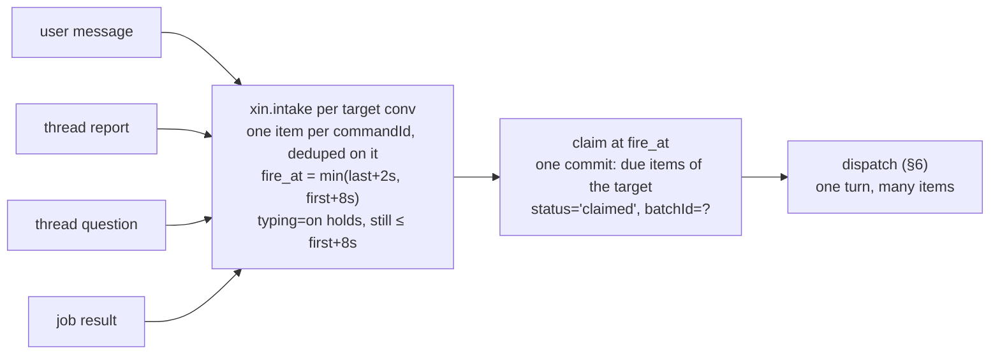
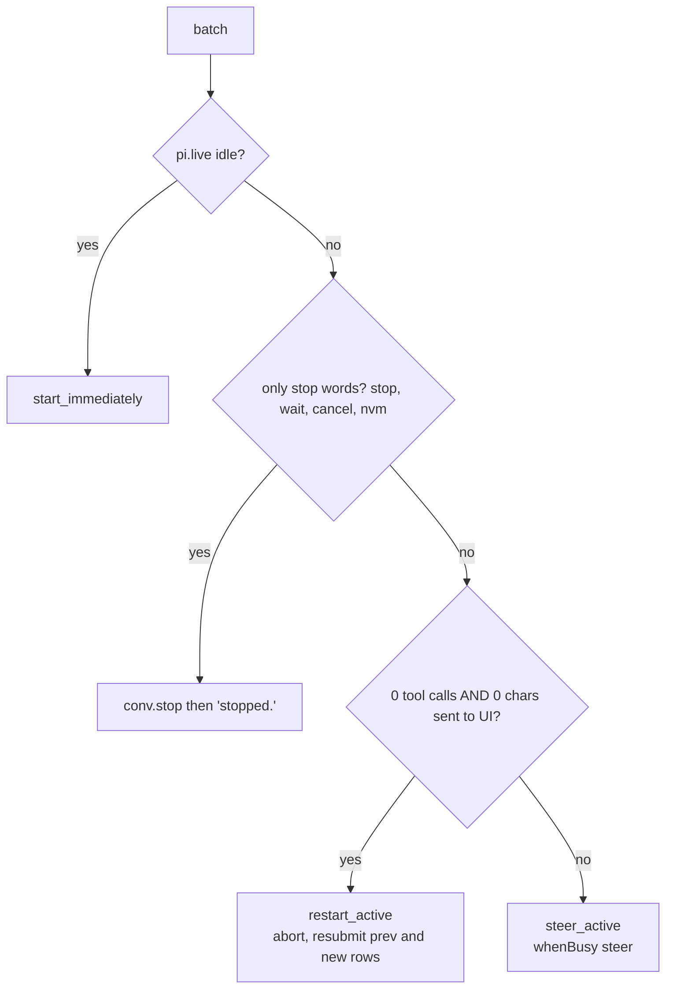

# 5–6 · Intake and dispatch

This section decides how inbound items are debounced and claimed as one batch, and how the host deterministically picks a dispatch mode for that batch.

Read with: [02 State](./02-state.md) for the `xin.intake` document, [03 Commands and wire](./03-commands-and-wire.md) for the command layer, [06 Orchestration](./06-orchestration.md) for the coordinator turn a batch feeds, [10 Time](./10-time.md) for the only timer Xin owns, [11 Failures and cost](./11-failures-and-cost.md) for the crash cases.

## 5 · Intake: answer the burst



The queue is one session document, `xin.intake` (§02), not a host table: `enqueue`, the claim, a listener's body rewrite and `markDone` are each one commit, so each costs one journal row instead of a table row plus its index rows. Reports use the same pipe: 8 threads finishing within 2 s cost ONE coordinator turn, not 8. A question answered in the UI before its item is claimed withdraws it (t3 rule: no stale notification turns).

**Rendering a batch.** The batch becomes one `submit({type:"input", content, entry:{kind:"xin.batch", data:rows}, requestId:"batch:"+id})`. The UI renders `xin.batch` as the original bubbles. The model sees one user message with items ordered by `clientTs`:

```text
<msg t="16:31:50">so like</msg>
<msg t="16:31:51">https://…</msg>
<msg t="16:31:52">can u setup</msg>
<thread id="th_7" title="Book ryokan" status="completed">Booked Kinosaki, ¥38k, free cancel to 20 Nov</thread>
```

**Attachments.** A user item may carry up to 12 files already stored through `PUT /files/<path>`. `plugins/intake/attachments.ts` stats each path, drops the ones storage does not have, and appends one block after the messages:

```text
<attachments>
- diagram.png (image/png, 1 204 912 bytes) at /projects/launch/attachments/diagram.png
- brief.txt (text/plain, 5 120 bytes) at /projects/launch/attachments/brief.txt
</attachments>
```

The sizes come from the file index, not from the client. A model that takes images also receives each image as an `image` part, read from R2 in parallel and encoded as base64, within one `INLINE_BUDGET_BYTES` (1 MiB) budget for the whole turn: an image that does not fit stays listed but is not sent, so the stored entry stays far under a Durable Object row and no single message can push the transcript past it. A text-only model gets the block alone and reads the file with its own tools.

This is the same text whether the coordinator is idle (it starts a turn) or busy (it steers).

**Crash safety**: one snapshot of the document drives the boot scan. Any `pending` item with `fireAt < now` fires at once, and any `claimed` item whose batch has no pi submission is resubmitted with the same `requestId`, which pi dedupes. Items become `done` after the submission settles, and `done` items are pruned at boot only, once they are 7 days old: `intake.batch` still answers `message.retry` for them, so they cannot be deleted at finish. The batch ledger in `kv` is what stops a replayed claimed batch from running the `intake/batch` waterfall twice.

## 6 · Dispatch: what a batch does to a running turn

t3 has four dispatch modes: start, steer, restart, queue. Xin implements start, steer and restart, and answers a batch of nothing but stop words with `stop` instead of queueing it; there is no `queue_after_active` mode in `plugins/intake/dispatch.ts`. The host picks the mode deterministically from `pi.live`. The LLM is never asked.



Restart is safe only before anything is visible or any side effect has happened. After that it would hide or repeat work, so the batch steers instead. Report and job batches always steer or start, and never restart.

**Silence and grunts.** The coordinator has `no_reply()` (returns `control:{terminate:true}`, and the UI shows nothing) and `react(emoji)`. The prompt rule: a batch that is only "oh", "hmm" or "ok" continues the previous topic or gets no reply. Low-value report batches, such as a thread that finished something you didn't ask about, can also be handled with `no_reply`. The Overview still shows them.
