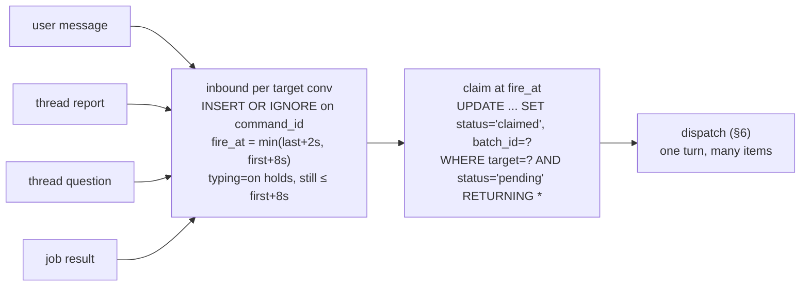
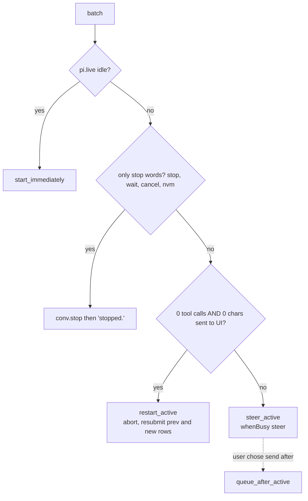

# 5–6 · Intake and dispatch

This section decides how inbound items are debounced and claimed as one batch, and how the host deterministically picks a dispatch mode for that batch.

Read with: [02 State](./02-state.md) for the `inbound` table, [03 Commands and wire](./03-commands-and-wire.md) for the command layer, [06 Orchestration](./06-orchestration.md) for the coordinator turn a batch feeds, [10 Time](./10-time.md) for the only timer Xin owns, [11 Failures and cost](./11-failures-and-cost.md) for the crash cases.

## 5 · Intake: answer the burst



Reports use the same pipe: 8 threads finishing within 2 s cost ONE coordinator turn, not 8. A question answered in the UI before its row is claimed deletes the row (t3 rule: no stale notification turns).

**Rendering a batch.** The batch becomes one `submit({type:"input", content, entry:{kind:"xin.batch", data:rows}, requestId:"batch:"+id})`. The UI renders `xin.batch` as the original bubbles. The model sees one user message with items ordered by `client_ts`:

```text
<msg t="16:31:50">so like</msg>
<msg t="16:31:51">https://…</msg>
<msg t="16:31:52">can u setup</msg>
<thread id="th_7" title="Book ryokan" status="completed">Booked Kinosaki, ¥38k, free cancel to 20 Nov</thread>
```

This is the same text whether the coordinator is idle (it starts a turn) or busy (it steers).

**Crash safety**: on boot, any `pending` row with `fire_at < now` fires at once, and any `claimed` row whose batch has no pi submission is resubmitted with the same `requestId`, which pi dedupes. Rows become `done` after the submission settles, and are pruned after 7 days.

## 6 · Dispatch: what a batch does to a running turn

t3 has four dispatch modes: start, steer, restart, queue. The host picks the mode deterministically from `pi.live`. The LLM is never asked.



Restart is safe only before anything is visible or any side effect has happened. After that it would hide or repeat work, so the batch steers instead. Report and job batches always steer or start, and never restart.

**Silence and grunts.** The coordinator has `no_reply()` (returns `control:{terminate:true}`, and the UI shows nothing) and `react(emoji)`. The prompt rule: a batch that is only "oh", "hmm" or "ok" continues the previous topic or gets no reply. Low-value report batches, such as a thread that finished something you didn't ask about, can also be handled with `no_reply`. The Overview still shows them.
