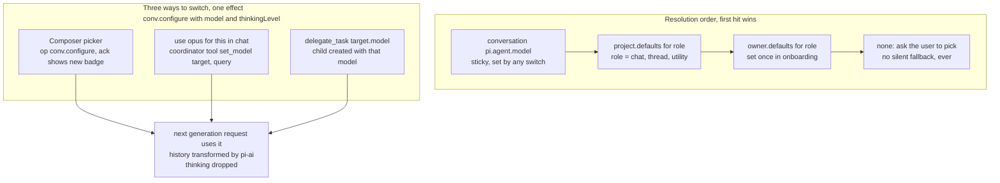

# 7 · Models

This section decides that model choice is entirely the user's, resolved from stored configuration at run time with no model ids in code, and that a switch applies at the next model request.

Read with: [02 State](./02-state.md) for where `pi.agent` and credentials live, [03 Commands and wire](./03-commands-and-wire.md) for `conv.configure`, [06 Orchestration](./06-orchestration.md) for `set_model` and `delegate_task`, [11 Failures and cost](./11-failures-and-cost.md) for provider failure behavior.

> **Rule:** there are no model ids in Ingle's code. The catalog comes from pi-ai at run time, the credentials are yours, and the choice is stored in each conversation's `pi.agent`. A switch takes effect at the **next model request**, so it can land inside a run that is already going.



A delegated thread resolves its model in this order: `delegate_task target.model`, the project's `thread` default, the owner's `thread` default, then the coordinator's current model as an explicit last fallback, then `none` (the tool returns `no_model`). The coordinator fallback keeps the common case — one model picked in the picker — working without configuring a thread default.

## The picker catalog

`models.catalog` (owner) is the picker's one read: every provider pi-ai knows with whether a stored key unlocks it and how many of its models are enabled, then up to 200 models ranked favourites, recent, current, with keyed models first. Each model carries its context window, max output, per-million prices (input, output, cache read, cache write), the thinking levels pi-ai's `getSupportedThinkingLevels()` allows, and the owner's `favorite` and `enabled` flags. `models.favorite` and `models.enable` toggle the two flags (`owner.favorites`, `owner.disabled` in `kv`). A disabled model stays in `models.catalog` with `enabled: false` and leaves every other path: `models.list` and `set_model` do not show it, and `conv.configure`, `owner.defaults`, `project.update`, `captain.create`/`captain.update`, `delegate_task` (target, defaults and the parent fallback), `thread.create` and `thread.side` refuse it through `ModelsService.disabled`, and `message.send` and `thread.send` refuse a turn on a conversation that still runs one. A model that is an owner or project role default cannot be disabled. Disabling moves every conversation on the home that runs the model (listed by `ctx.pi.conversations()`, a scan of the harness's in-memory storage: Puck chats, threads pruned from their space and automation threads included) to the default its role resolves to, from its next request; with none left its model is cleared and its next turn asks for one. `conv.configure` refuses a thinking level the model does not support instead of clamping it. Each catalog and `models.list` entry carries `modes`: `["fast"]` where pi-ai can both send and price a faster tier, which today is OpenAI's priority `service_tier` on the `openai` provider's Responses API (pi-ai bills a response at the tier it reports); every other model has `[]`. `conv.configure { fast }` turns Fast mode on or off for a conversation (`xin.fast` conversation doc, `{ on }`), refuses `fast: true` on a model without it, and turns it off when the conversation switches to such a model. A `beforeProviderRequest` hook adds `service_tier: "priority"` to the request body while it is on, so usage and cost record fast spend at its real price.

A selection is a conversation's `pi.agent`, so the model and thinking level of a thread or a Captain's conversation persist through `conv.configure` like any chat's.

## The `set_model` tool

```text
set_model({ target: "this_chat" | "thread:<id>" | "new_threads" | "project_default", query: string, thinking?: "off"|"minimal"|"low"|"medium"|"high"|"xhigh"|"max" })
 1. candidates = catalog.search(query)        // fuzzy over provider, id, name; only providers with working auth
 2. 0 hits      → error listing close matches + "add a provider key in Settings"
    >1 strong   → return the top 4 to the model; it asks you ("opus 5.5 or opus 5?")
    1 hit       → ops.run("conv.configure", …) as actor conv:<self>
 3. result: { model, contextWindow, vision, reasoning, effectiveFrom: "next request" }
```

Because the switch applies at the next request, "switch to X and answer this" works in a single run: the tool result is committed, and the very next generation in that run calls X.

## Edges

| Edge | What happens |
| --- | --- |
| New model's context window is smaller than the current context | pi's compaction threshold is `contextWindow − reserveTokens` of the model about to run, so the next request waits for a compaction first. Proven in `plugins/models/models.test.ts`, with one limit: pi can't cut at the first entry, so a conversation whose only turn is oversized never compacts. Once a second turn exists the switch compacts before the next request. |
| New model has no image input | pi substitutes a placeholder, and `set_model` says "this model can't see images" in its result. |
| New model has no reasoning | `thinkingLevel` is ignored, and the picker greys it out from `model.reasoning`. |
| Prompt cache | It is cold once, on the first request after a switch. pi keeps `sessionId` per conversation across switches. |
| Cache retention | The harness asks for `cacheRetention: "long"` (`src/kernel/pi.ts`): a coordinator or the root chat answers messages minutes apart, so a one-hour write (2x input) read at 0.1x beats a five-minute write (1.25x) repaid after every gap. A thread runs tight tool rounds, so the orchestrator's `beforeProviderRequest` hook drops the `ttl` from the cache directives pi-ai writes (Anthropic-format `cache_control`, Bedrock `cachePoint`) on system blocks, tool declarations, messages and their content blocks for a conversation that has a `ThreadDoc`; tool arguments, schemas and binary content are never walked, which puts it back on the five-minute default. pi 1.5 resolves stream options per harness, not per conversation, so the payload hook is the only per-conversation seam. OpenAI formats keep long retention: their extended retention has no write premium. |
| Provider outage mid-thread | pi retries, then the run fails and the report says which provider failed. Switching the model and saying "retry" resumes. |
| Hundreds of models (OpenRouter) | `capabilities()` returns only favorites, recent and the current model, plus an `omittedModels` count. `set_model` searches the rest. This is t3's trick for keeping context small. |
| Utility work (memory pass, titles) | Uses `defaults.utility`. If that isn't set, it uses the model of the conversation that produced the work. It is never hard-coded. |

**Credentials**: `SealedCredentialStore implements CredentialStore` over the `credentials` table (seal/unseal with the `KEK` secret). pi's `modify()` serializes OAuth refresh, so subscription logins work. Custom OpenAI-compatible endpoints use `createProvider()` from a stored `{baseUrl, key, api}`, so any model with an HTTP API counts.

## Context usage

`conv.context { conv? }` (owner and agent, same scope as `conv.configure`) answers the composer's Context popover: `{ conversation, model | null, contextWindow, used, measured, categories: [system, tools, conversation] (each { key, tokens }), compactAt }`. `used` is the newest assistant usage in the active context (input + cacheRead + cacheWrite + output) with `measured: true`; before any reply it is an estimate of the whole prompt with `measured: false`. `system` and `tools` estimate the resolved agent's rendered sections and tool declarations with pi-ai's `estimateTextTokens`; `conversation` is `used - system - tools`, floored at 0. `compactAt` is `contextWindow` minus pi-durable's `DEFAULT_COMPACTION_POLICY.reserveTokens`, because Ingle sets no harness compaction settings or model overrides. The op reads the harness's committed context and agent and writes only its command receipt.

## Usage by feature and per-feature caps

Spend is booked per feature: `chat` (the home chat, Puck chats and project coordinators), `thread`, `captain` (Captain coordinators, listed by the orchestrator through `ModelsService.track`), `automation` (threads that automation runs started, registered the same way from `automation_runs`, read once per process), `dreamer`, `goal` (a chat or thread with an armed, active goal), `compaction`, and `other` (any conversation none of these claims). Flushes run one at a time, so overlapping usage reads never book the same growth twice. The flush that already books `usage_daily` once a minute walks every conversation (`ctx.pi.conversations()`, a scan of the in-memory storage the harness runs on, so it reads no row), compares each one's `pi.usage` models and tools (tools keyed `tool/<name>`) with the marks held in memory and stored in `usage.marks` in `kv`, and adds the growth to `usage_feature (day, feature, model)`; so the features sum to `usage_daily`. Only a conversation with new untagged spend is classified, and only a chat or thread pays the goal lookup's row. A background call made outside a generation (the Dreamer, a compaction summary) goes through `ModelsService.charge`, which adds it to the conversation's `pi.usage` under `<feature>:<provider>/<model>`, so it counts toward `usage_daily` and the monthly cap and keeps its own feature line; `usage.summary` folds the tag back into one line per model. The compaction hook makes the summary call itself, on the utility model and then on the conversation's model when there is none, it is the same model, or the call fails, so pi's own summarizer (untagged) runs only when both fail.

Each feature can have a daily and a monthly cap (`usage.feature.caps` in `kv`, held in memory). A cap is checked where work starts, because pi skips a hook that throws: `message.send` checks its target's feature; `delegate_task`, `thread.create` and `thread.side` check `thread`; a thread's report checks its coordinator's feature and, when capped, is not delivered (the result stays on the thread for `thread.status`); an automation run checks `automation` when it is dispatched and, when capped, fails with the cap as its error; `thread.send` checks the thread's feature; a goal round checks `goal`; the Dreamer and compaction check before their model call, and a capped compaction is declined. The check adds the spend not yet flushed, measured in memory from the session ledger and the marks; the classifications it makes are kept for the next flush, so an admission costs no extra row. A run already under way finishes its rounds. Ops: `usage.features`, `usage.feature.cap.set`, `usage.cost` (per conversation), `usage.crew` (a space's coordinator and crew), `usage.today`, and the home part `spend`.
