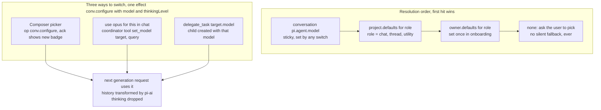

# 7 · Models

This section decides that model choice is entirely the user's, resolved from stored configuration at run time with no model ids in code, and that a switch applies at the next model request.

Read with: [02 State](./02-state.md) for where `pi.agent` and credentials live, [03 Commands and wire](./03-commands-and-wire.md) for `conv.configure`, [06 Orchestration](./06-orchestration.md) for `set_model` and `delegate_task`, [11 Failures and cost](./11-failures-and-cost.md) for provider failure behavior.

> **Rule:** there are no model ids in Xin's code. The catalog comes from pi-ai at run time, the credentials are yours, and the choice is stored in each conversation's `pi.agent`. A switch takes effect at the **next model request**, so it can land inside a run that is already going.



A delegated thread resolves its model in this order: `delegate_task target.model`, the project's `thread` default, the owner's `thread` default, then the coordinator's current model as an explicit last fallback, then `none` (the tool returns `no_model`). The coordinator fallback keeps the common case — one model picked in the picker — working without configuring a thread default.

## The `set_model` tool

```text
set_model({ target: "this_chat" | "thread:<id>" | "new_threads" | "project_default", query: string, thinking?: "off"|"low"|"medium"|"high" })
 1. candidates = catalog.search(query)        // fuzzy over provider, id, name; only providers with working auth
 2. 0 hits      → error listing close matches + "add a provider key in Settings"
    >1 strong   → return the top 4 to the model; it asks you ("opus 5.5 or opus 5?")
    1 hit       → ops.run("conv.configure", …) as actor conv:<self>
 3. result: { model, contextWindow, vision, reasoning, effectiveFrom: "next request" }
```

Because the switch applies at the next request, "switch to X and answer this" works in a single run: the tool result is committed, and the very next generation in that run calls X.

## Edges

| Edge | What happens |
| --- | --- |
| New model's context window is smaller than the current context | pi's compaction threshold is `contextWindow − reserveTokens` of the model about to run, so the next request waits for a compaction first. Proven in `src/models.test.ts`, with one limit: pi can't cut at the first entry, so a conversation whose only turn is oversized never compacts. Once a second turn exists the switch compacts before the next request. |
| New model has no image input | pi substitutes a placeholder, and `set_model` says "this model can't see images" in its result. |
| New model has no reasoning | `thinkingLevel` is ignored, and the picker greys it out from `model.reasoning`. |
| Prompt cache | It is cold once, on the first request after a switch. pi keeps `sessionId` per conversation across switches. |
| Provider outage mid-thread | pi retries, then the run fails and the report says which provider failed. Switching the model and saying "retry" resumes. |
| Hundreds of models (OpenRouter) | `capabilities()` returns only favorites, recent and the current model, plus an `omittedModels` count. `set_model` searches the rest. This is t3's trick for keeping context small. |
| Utility work (memory pass, titles) | Uses `defaults.utility`. If that isn't set, it uses the model of the conversation that produced the work. It is never hard-coded. |

**Credentials**: `SealedCredentialStore implements CredentialStore` over the `credentials` table (seal/unseal with the `KEK` secret). pi's `modify()` serializes OAuth refresh, so subscription logins work. Custom OpenAI-compatible endpoints use `createProvider()` from a stored `{baseUrl, key, api}`, so any model with an HTTP API counts.
