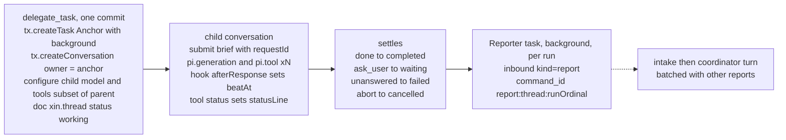
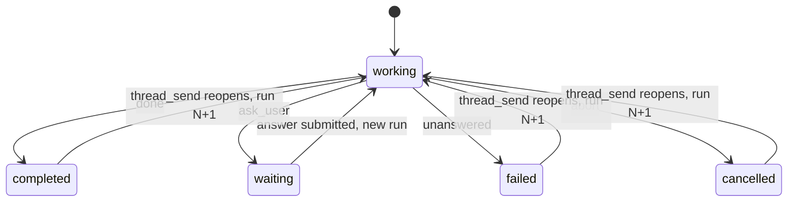
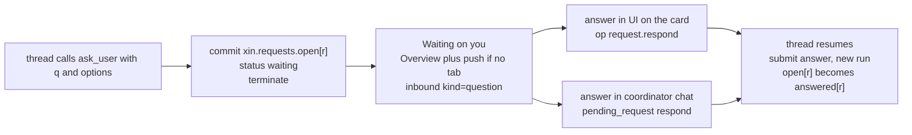

# 8–12 · Orchestration

This section decides the coordinator's tool surface, a thread's life as pi objects, how slow tools become jobs, how a question ends a turn, and how the watchdog makes every failure visible.

Read with: [02 State](./02-state.md) for `xin.thread` and `xin.requests`, [04 Intake and dispatch](./04-intake-and-dispatch.md) for the batch a report or question enters, [05 Models](./05-models.md) for `set_model` and per-thread models, [07 Memory](./07-memory.md) for what a thread can recall, [10 Time](./10-time.md) for schedules, [11 Failures and cost](./11-failures-and-cost.md) for the failure matrix.

## 8 · Orchestrator tools (t3 contract, ported onto pi)

The coordinator gets this tool surface. Threads get a narrower version (no `delegate_task` by default, so there are no grandchildren unless the project allows them).

| Tool | Input | Implementation on pi |
| --- | --- | --- |
| `capabilities` | - | current model, short model list, thread limits, enabled plugins |
| `delegate_task` | `{task, title, role?, target?:{model}, mode:"async"\|"wait", timeoutMs≤8000, clientRequestId}` | one `api.commit`: background Anchor task + task-owned child conv + `xin.thread` doc + workspace threadIds. Then submit the brief with requestId `delegate:…`. In `wait` mode, wait on the child's submission with a deadline |
| `task_status` | `{threadId}` | reads `xin.thread` + last assistant text |
| `task_cancel` | `{threadId, reason?}` | `conversation.abort({background:true})` on the child, status → cancelled |
| `thread_send` | `{threadId, text, mode:"steer"\|"queue"}` | child `submit` with that `whenBusy`. On a resolved thread it starts a new run in the same conversation |
| `thread_read` | `{threadId, after?}` | entries after a cursor, text only, bounded at 4k tokens |
| `thread_list` | `{projectId?, status?}` | projection of the workspace and thread docs |
| `pending_request` | `{action:"list"\|"read"\|"respond", threadId?, requestId?, answer?}` | §11 |
| `schedule` / `unschedule` | `{rrule\|at, prompt, projectId}` | §16 |
| `set_model` | §7 | |

> **A child receives only its brief and role, never the parent's history.** This is the t3 rule. Briefs have to be self-contained, threads start cheap and focused, and nothing private leaks into a thread by accident. A thread pulls what it needs with `read`, `recall` and `thread_read`.

**Policy ceiling** (t3): a child's tools are a subset of its parent's. Its file scope is equal to or narrower than the parent's (default `project`). Its plugin set is the project's selection. `delegate_task` refuses anything broader with `capability_denied`.

## 9 · A thread's life in pi terms



Thread status transitions:



- **Why an Anchor task**: a child owned by a background task is outside the coordinator's abort and idle boundary. If you stop the coordinator, threads keep going. To stop everything, use `abort({background:true})`. This is pi example 22.
- **Result text** is the last assistant message of the final run. A failed run shows its provider error before any progress text (t3).
- **Re-opening** a resolved thread with `thread_send` starts run N+1 in the same conversation, sets status back to `working`, and creates a new Reporter with key `report:th:N+1`.
- **Limits** (from owner settings, never hidden): live threads per project and per owner. Over the limit, `delegate_task` returns `limit_reached` with the list of live threads, and the coordinator tells you.

You steering a thread directly in the UI = `op thread.send(steer)`. Same path the coordinator's `thread_send` uses.

## 10 · Jobs: one code path, two latencies

Any tool declared `latency:"maybe-slow"` (web research, a large fetch, an MCP call) is wrapped once with `wrapTool`:

```text
execute(args, api, ctx):
  job = api.createTask(Job, {tool, args}, {background:true})     // the real call runs in the Job's phase
  r   = await waitWithDeadline(job, 8000)                          // cancelling the wait never cancels the work
  if r.done   → return r.result                                     // felt synchronous
  else        → doc xin.jobs[job] = {tool, startedAt}; return "started (job j_42), result will follow"
Job.finish  → inbound kind=job, command_id="job:"+id               // lands as a batch item (§5)
```

A job is a thread with no conversation: it shows in the Overview, the watchdog covers it, and `task_cancel` works on it. The coordinator never has to decide up front whether something is slow.

## 11 · Questions: a question ends the turn, the answer starts the next



- `respond` also DELETEs the question's inbound row if still pending, so the coordinator never gets a turn about an answered question.
- Why not a tool that waits for the answer: a held tool task across hours of eviction needs replay tricks; a finished run needs nothing.
- `respond` is idempotent on `requestId`: the second answer to the same question returns `already_answered`.

## 12 · Watchdog: failures are always visible

```text
Watchdog = one pi background task (key "xin.watchdog"), phases: sleep → check → sleep
 sleep:  runtime.sleepUntil(now+30s)  — exists only while any thread/job is live; otherwise it finishes
 check, per live thread/job:
   stalled  = now − beatAt > 120s AND no tool in pi.live has tool.expectedMaxMs covering it
   overtime = now > deadlineAt                       (project setting, default 30 min)
   → child.abort() · xin.thread.status="failed" · result="stopped: no progress for 2 min in web_research"
   → the Reporter posts it like any other result
 beatAt is written by hook(GenerationTask.afterResponse) and hook(ToolTask.afterTool): ~1 row per step
```

A coordinator run that fails (provider error, compaction failure) commits one `xin.error` entry into the chat, which the UI renders as an error bubble with a retry button (`op message.retry` resubmits that batch). Nothing fails silently.
