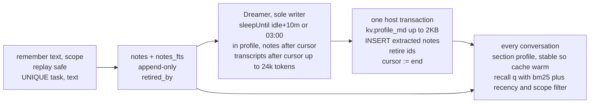

# 13 · Memory

This section decides that notes are appended from anywhere with idempotent keys and curated by exactly one Dreamer task, with the profile as the only mutable memory artifact.

Read with: [02 State](./02-state.md) for `notes`, `notes_fts` and `kv`, [04 Intake and dispatch](./04-intake-and-dispatch.md) for how a memory pass is scheduled as work, [06 Orchestration](./06-orchestration.md) for `recall` and `memory.forget`, [11 Failures and cost](./11-failures-and-cost.md) for the failure cases.

- **Why there's no locking**: notes are inserts only, and two inserts never conflict. The profile has exactly one writer, a singleton task keyed `xin.dreamer`. Readers read whatever was last committed. Nothing is ever read, modified and written back by two actors.
- **Dreamer output contract**: `{profile_md, add:[{text,scope}], retire:[noteId]}`, validated against size ≤ 2 KB, no sealed-credential or plugin-secret value, and no instruction-shaped text. `retire` must be a deduplicated subset of the note ids shown in that pass. On an invalid result it retries once, then skips the pass without moving the cursor, so nothing is lost.
- **Scopes**: `me` and `project:<id>`. A thread recalls `me` plus its own project, and both tools refuse any other scope. `remember` defaults to the caller's project when it has one, else `me`. The profile only holds `me` material.
- **Forget**: `memory.forget(query)` retires notes matching every word of the query at once and queues a Dreamer pass, so the profile drops the fact within minutes. `memory.forget(id)` retires exactly one note, which is what the Memory pane uses; a note can be longer than a query may be.
- **Owner curation**: `memory.list` returns live notes pinned first, then newest, each with its `source`. `memory.add(text, scope?)` appends one by hand under the command's own `origin_task` (so a replay is safe) and arms a pass. `memory.pin(id, pinned)` raises or lowers a note. `memory.edit(id, text)` rewrites its text, marks it `dirty`, and arms a pass; the pass selects `id > cursor OR dirty = 1`, so an edited note the cursor already passed is re-read once, then the flag clears. `notes_fts` stays in step through the `notes_au` trigger. The Memory pane drives all four; only the owner may.
- **Suggestions**: `memory.suggested(conversationId, scope?)` reads that conversation's last owner message and returns up to two sentences that read like a standing rule (they match a fixed phrase list: always, never, don't, do not, from now on, make sure, prefer, use). It never writes: a suggestion already held by a live note or listed in `kv memory.dismissed` (capped 50, written by `memory.dismiss`) is left out. The Memory pane shows the rest as one-click Remember/Edit/Dismiss cards, so keeping a rule never costs a Dreamer pass.
- **Guard**: `remember` refuses text that looks like an instruction or holds credentials. Fetched web content can't plant memory through the model (hermes scans the same way).
