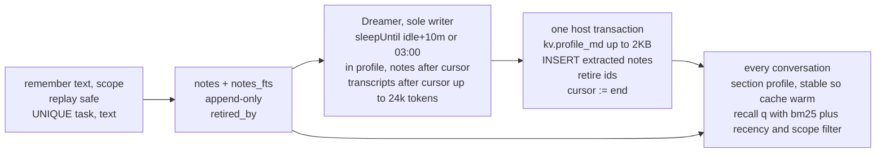

# 13 · Memory

This section decides that notes are appended from anywhere with idempotent keys and curated by exactly one Dreamer task, with the profile as the only mutable memory artifact.

Read with: [02 State](./02-state.md) for `notes`, `notes_fts` and `kv`, [04 Intake and dispatch](./04-intake-and-dispatch.md) for how a memory pass is scheduled as work, [06 Orchestration](./06-orchestration.md) for `recall` and `memory.forget`, [11 Failures and cost](./11-failures-and-cost.md) for the failure cases.

- **Why there's no locking**: notes are inserts only, and two inserts never conflict. The profile has exactly one writer, a singleton task keyed `xin.dreamer`. Readers read whatever was last committed. Nothing is ever read, modified and written back by two actors.
- **Dreamer output contract**: `{profile_md, add:[{text,scope}], retire:[noteId]}`, validated against size ≤ 2 KB, no sealed-secret substrings, and no instruction-shaped text. On an invalid result it retries once, then skips the pass without moving the cursor, so nothing is lost.
- **Scopes**: `me` and `project:<id>`. A thread recalls `me` plus its own project. The profile only holds `me` material.
- **Forget**: `memory.forget(query)` retires the matching notes at once and queues a Dreamer pass, so the profile drops the fact within minutes.
- **Guard**: `remember` refuses text that looks like an instruction or holds credentials. Fetched web content can't plant memory through the model (hermes scans the same way).
