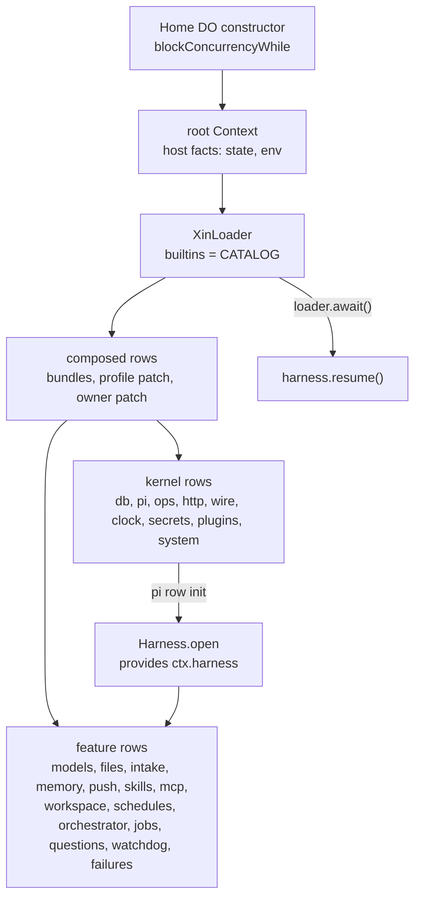

# 15 · Plugins: everything is a plugin

This section decides that Xin's plugin layer is the one deepseek-harness (dsh) uses: Cordis contexts, services, typed events and reversible effects, composed from a tree of loader rows. There is no privileged core. The kernel services, pi-durable itself and every feature are rows that a patch can configure, disable or replace.

Read with: [01 Host](./01-host.md) for the alarm loop the `clock` service owns, [03 Commands and wire](./03-commands-and-wire.md) for the `ops` and `wire` services, [05 Models](./05-models.md) for the `models` seam.

## Stack

| Package | Version | Role |
| --- | --- | --- |
| `@deepseek-ai/cordis` | 4.1.0 | Context, Service, plugin registry, fibers, events, effects |
| `@deepseek-ai/cordis-plugin-loader` | 1.1.0 | the entry tree: rows, groups, isolates, update, disable |
| `@deepseek-ai/schemastery` | 3.19.0 | plugin `Config` schemas, serialisable for settings forms |

The loader runs in workerd unchanged. It needs one build define, `import.meta.url = "file:///bundle/index.js"`, because it calls `createRequire(import.meta.url)` when constructed. `XinLoader` sets `internal = undefined`, and every row's `name` is a `cordis:<catalog name>` builtin. Nothing is imported at run time. pi-schema stays the schema for tool parameters, op args and wire frames. schemastery is only for plugin config.

## Model



- **A plugin is a Cordis plugin.** It is a module with `name`, `inject`, `Config` and `apply(ctx, config)`, or a `Service` subclass. It needs only the services named in `inject`, never a concrete module.
- **Every registration is an effect.** Extensions, tools, ops, routes, timers, home snapshot parts and listeners return a disposer. Disposing or reconfiguring a plugin unwinds exactly what it added.
- **Boot order comes from `inject`.** It does not come from list order. A row stays pending until its services exist, and it unloads when one goes away.
- **The `pi` row owns the Harness.** Its init opens the Harness, provides `harness`, and closes it on dispose. Rows that need the Harness name `harness` in `inject`, so they start after it and restart with it. Scheduling stays off until `Home` calls `harness.resume()` after `loader.await()`, so a resumed task finds its definition installed. A row's startup work runs in its own `apply`. A failure fails only that row, and the row's disposers (commit observers included) run when it is disabled.

## Kernel services (seams)

Each service is a row in `xin-base`. A different row can provide the same key in its place.

| Key | Row | Surface |
| --- | --- | --- |
| `host` | root facts, not a row | `state: DurableObjectState`, `env: Env`, `abort(reason)` |
| `db` | `db` | `SqliteDatabase` plus `applySqliteMigrations(owner, steps)`. Host steps stay in the append-only `HOST_MIGRATIONS`, and a plugin's own tables use its own migration list, tracked in the table `migrations_<owner>` |
| `pi` | `pi` | `registry`, `install(extension)` (effect), `models(fn)` and `env(fn)` providers (effects), `open()` |
| `harness` | `pi` (provided by its init) | the pi-durable `Harness`, closed when the `pi` row unloads |
| `ops` | `ops` | `define(op)` (effect), `run(command, actor)`, `list()`. Receipts as in §3 |
| `http` | `http` | `route("GET /path" or "GET /prefix*", handler)` (effect), `handle(request)` |
| `wire` | `wire` | sockets, `home(part, fn)` (effect), `publishHome()` |
| `clock` | `clock` | `timer({ due, fire })` (effect), `arm(wake)`, `fire(now)`. It owns the single DO alarm (§1) |
| `secrets` | `secrets` | `get(key)` and `set(key, value)` over values sealed with `KEK`, scoped to the calling row's loader entry id (found with `loader.locate`). `values()` is kernel-only and feeds the redaction hook. Defines the owner op `plugin.secret.set` |
| `plugins` | `plugins` | the plugin manager below |
| `system` | `system` | version, restart, update. Deploys go through the `deployer` seam |

Feature services follow the same pattern (`models`, `files`, `memory`, `push`, `skills`, `mcp`, `workspace`, `threads`, `jobs`, `questions`). A feature that other features call provides a key. A feature that only adds tools, ops or timers provides none.

**Service rows and tool rows.** A feature package splits what it serves from what the model sees.

- The service row (`<name>`) owns state, ops, routes, timers and the home part, and provides `ctx.<key>` (`files`, `models`, `threads`, `jobs`, `intake`, `memory`, `questions`, `skills`, `schedules`, `mcp`, `watchdog`, `push`, `workspace`). A `hostModule` feature returns it as `provides: { <key>: value }`.
- The tool row (`tool-<name>`) is a plain plugin with `inject: ["pi", "<key>"]` that installs one extension, named `tool-<name>`, holding the model-facing tools (and their prompt sections). Disabling it removes those tools and leaves the service running.
- Both rows are declared in the package's `xin.plugins` and listed in its `xin.bundle`.
- Each service's interface lives in `src/contracts/<key>.ts`, which augments Cordis `Context` with `<key>: <Interface>`. That folder holds only types, doc definitions, schemas and pure helpers. A plugin may import `src/contracts/*`, `src/kernel/index.ts` and shared libs in `src/`, never another plugin's files. Calls into another feature go through `inject` (required) or `ctx.get(key)` (optional). A `hostModule` feature names the services it calls in `hostModule(name, create, uses)` and reads them as `deps.services.<key>` at call time (`deps.services.get(key)` when optional, as intake does for `push`). Each plugin reads and writes only its own SQL tables; `src/kernel/dbtables.ts` maps every table to its owning plugin or `kernel`, and `bun scripts/boundaries.ts`, run by `lint`, fails on any import from one plugin (or test plugin) into another, and on any SQL that names another feature's table. The kernel's `kv`, `receipts`, `plugins` and migration tables are shared infrastructure.

| Key | Provider row | Called by |
| --- | --- | --- |
| `intake` | `intake` | jobs, watchdog, orchestrator, questions, schedules, failures |
| `push` | `push` | intake (optional) |
| `jobs` | `jobs` | mcp, watchdog, orchestrator |
| `watchdog` | `watchdog` | orchestrator, questions |
| `models` | `models` | orchestrator, memory, tool-models |
| `threads` | `orchestrator` | questions, tool-orchestrator |
| `files` | `files` (or any row, e.g. the test `fake-files`) | tool-files |

 `ctx.pi.install(defineExtension({ ... }))` accepts any pi extension: tools, `wrapTool`, hooks, prompt sections, tasks, docs. It installs it in the live registry and calls `registry.uninstall` on dispose. pi treats a reinstall under the same name as a hot replace, so a reconfigured plugin swaps its extension in place.

## Events

Events are declared on Cordis `Events` with an `@mode` tag. The dispatch mode is part of the contract.

| Event | Mode | Use |
| --- | --- | --- |
| `ops/before(call, next)` | waterfall | policy over every op: deny, rewrite args, or observe. `call = { command, actor }` returns an `Outcome` |
| `intake/batch(batch, next)` | waterfall | annotate or rewrite a claimed batch before dispatch |
| `thread/settled(event)` | emit | a thread reached a terminal status |
| `wire/typing(conversation, on)` | parallel | typing indicators |
| `plugins/changed()` | emit | the composed tree or a row's state changed |
| `mcp/changed()` | emit | the MCP server tool set changed; `tool-mcp` republishes its extension |

Turn, tool and request interception stay pi-native: install an extension with hooks or `wrapTool`.

## Rows, bundles and layers

A row is a loader `EntryOptions`: `{ id, name: "cordis:<plugin>", config?, disabled?, group?, isolate? }`.

- **Catalog.** `src/catalog.ts` lists only the required kernel rows (`db`, `clock`, `pi`, `ops`, `http`, `wire`, `secrets`, `plugins`, `system`) in the `xin-base` bundle. Every feature is a package under `plugins/<name>/` (models, files, intake, memory, push, skills, mcp, workspace, schedules, orchestrator, jobs, questions, watchdog, failures, deploy-hook, time), and the generated `src/catalog.gen.ts` lists them and installed dependencies, one bundle per package. Entries are `{ plugin, title, description, required?, multiple?, source }`. A package can never declare a core plugin, bundle or row id.
- **Feature modules** (models, files, intake and the rest) keep their `create(deps): HostModule` shape and mount through `hostModule(name, create)` (`src/kernel/hostmodule.ts`). It injects `harness` and turns each part into an effect: extensions through `pi.install`, ops through `ops.define`, routes, the home part, timers and typing. `start()` runs inside `apply` and may return a disposer. Their helpers take narrow ports (`{ db, arm }`) that tests build directly. New plugins write `apply(ctx)` against the services, as the time plugin does.
- **Bundles.** A bundle is an ordered list of rows. `xin-base` holds the kernel rows. `xin.profile.json` names `xin-base` and every feature package's bundle. A package can ship its own bundle.
- **Layers**, applied in order to an empty list (as in dsh):
  1. The bundles named in `xin.profile.json`, in order.
  2. That file's `patch`. It is build time and checked in.
  3. The owner patch. It is run time and stored in the `kv` key `plugins.patch`.

  The last write wins per row.
- **Patch semantics (dsh).**
  - `{ insert: [rows] }` appends rows.
  - `{ id, ...fields }` replaces each named field of that row whole, `config` included, with no deep merge.
  - An unknown id is reported and skipped.
- **Persistence.** `XinLoader.commit(change)` recomputes the owner patch as the minimal departure from the lower layers and stores it, so the owner patch records only what the owner changed.
- **Failure.**
  - A failed `required` row puts Home in `boot_failed`. `/v1/status` reports it and ops return `unavailable`.
  - Any other failed row is reported as `failed` with its error, and the rest keep running.
  - A row whose plugin is missing from the catalog, for example after a removal, is reported as `missing` and is not mounted.

## Plugin manager (`plugins` row)

| Op | Effect |
| --- | --- |
| `plugin.list` | rows with id, name, state (`active`, `pending`, `failed`, `disabled`, `missing`), error, layer, config and its schema JSON |
| `plugin.catalog` | compiled plugins with meta, `Config` schema JSON and the package they came from |
| `plugin.tree` | the composed rows with the layer that set each field (dsh `--dump-config`) |
| `plugin.enable` | `{ id, enabled }`. Rejected for a `required` row |
| `plugin.configure` | `{ id, config }`, validated against the plugin's `Config` before it is committed. Rejected for a plugin with no `Config` (every kernel service but `plugins`) and for a `missing` row |
| `plugin.insert` | `{ id, plugin, config }` adds a catalog plugin as a new row. Rejected for a `required` plugin, and for a second row of a plugin unless its catalog entry sets `multiple: true` (most plugins register fixed tool and op names, so a second copy could only fail). `time` sets it: an extra row names its extension after the row id and its tool `current_time_<row>`. A package declares it as `xin.plugins.<name>.multiple: true` |
| `plugin.remove` | removes a row that the owner patch inserted, including a `missing` one |
| `plugin.reset` | drops the owner's override for a row, back to the lower layers |
| `plugin.secret.set` | `{ id, key, value }` for row `id`, sealed by `secrets` (the op lives in the `secrets` row) |

Every mutating result carries `application: "applied" | "failed"` and the row's new state. A change applies live in place through Cordis disposal. New code always means a rebuild and `system.update`.

The agent tool `plugin_manager` is its own row, `tool-plugins` (`src/kernel/managertool.ts`, not required). It takes `action: list | catalog | tree | enable | configure`. It mutates only when the `tool-plugins` row config has `allowAgent: true`, and otherwise tells the model which owner op to suggest. An owner op is always allowed.

A row whose new config or code fails to start is an outcome, not an error: the op returns `application: "failed"` with the row and its recorded error, and the other rows keep running.

## Install, update, restart

- **Code is installed at build time.** It cannot be installed in a running Worker.
  - A plugin package declares itself in `package.json`: `"xin": { "plugins": { "<name>": { "module": "./index.ts", "title", "description" } }, "bundle"?: [{ "id", "plugin", "config"?, "disabled"? }] }`. Without `bundle`, each plugin gets one row with its own name as the id. The bundle is named after the package.
  - `bun scripts/xin.ts plugin add <npm spec | git url | path> [--enable]` runs `bun add`, regenerates `src/catalog.gen.ts` and, with `--enable`, appends the bundle to `xin.profile.json`. `generate`, `list`, `enable`, `disable` and `remove` work the same way. In-repo packages under `plugins/*` are found without installing.
  - `plugin remove` and `plugin list` work the same way. Then deploy.
- **`system.version`** reports the build id (the `XIN_BUILD` define), the package versions, the bundles and whether the tree is degraded.
- **`system.restart`.**
  - `{ hard: false }` disposes the root context and boots it again in place, with the same code and fresh fibers.
  - `{ hard: true }` calls `state.abort()`, so the DO restarts on the next request.
- **`system.update`** asks the `deployer` seam to deploy. The default row, `deploy-hook`, POSTs to a URL stored as its secret, such as a GitHub `workflow_dispatch` or a Cloudflare Workers Builds deploy hook. The new version comes up when Cloudflare restarts the DO on the new code. The result is `{ application: "deploying" }`, and the client polls `system.version`.

## Authoring a plugin

```ts
import { defineExtension, defineTool } from "@earendil-works/pi-durable"
import { obj } from "@earendil-works/pi-schema"
import { type Context, Schema } from "../src/kernel/index.ts"

export const name = "hello"
export const inject = ["pi", "ops"]
export const Config = Schema.object({ greeting: Schema.string().default("hi") })

export function apply(ctx: Context, config: { greeting: string }) {
  ctx.pi.install(
    defineExtension({
      name: "hello",
      tools: [
        defineTool({
          name: "hello",
          description: "Say hello.",
          parameters: obj({}),
          execute: async () => ({ output: [{ type: "text", text: config.greeting }] }),
        }),
      ],
    }),
  )
  ctx.on("ops/before", async (call, next) =>
    call.command.op === "hello.forbidden" ? { kind: "rejected", code: "forbidden", message: "no" } : next(),
  )
}
```

## Trust

In-process plugins run in the Home isolate with full access to what they `inject`, as in dsh. Installing a package is the trust decision. There is no network allowlist. Secrets are scoped by the calling row's id, so one row cannot read another's values by accident, but in-process scoping is not a security boundary. Running untrusted third-party code needs a separate isolate (Worker Loader) behind the same services over RPC. That is later.

## Later

- **Per-project capability sets (dsh presets).** A project names the extension set its conversations select, through pi `configure({ extensions })`.
- **A market index.** A read-only list of plugin packages, with an install hint, for the CLI.
