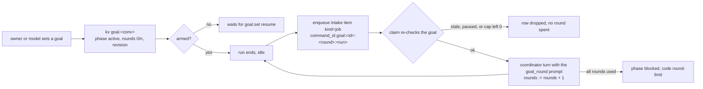

# 19 · Always-on: clock, compaction, loop guard, schedules and goals

This section decides what makes Xin usable as an agent that runs unattended for hours: it knows what time it is, it can be compacted on demand, it is nudged out of a tool loop, it can schedule its own future work, and it can carry one objective across many rounds. Every mechanism here is a port of a named dsh package. Nothing is invented (owner rule 2026-11-07, and the owner's approval of this list on 2026-11-07).

Read with: [10 Time](./10-time.md) for the alarm the rounds share, [06 Orchestration](./06-orchestration.md) for the run a round continues, [04 Intake and dispatch](./04-intake-and-dispatch.md) for the batch a fire becomes, [11 Failures and cost](./11-failures-and-cost.md) for what each wake costs.

## Ambient clock (`time` row, dsh `context/time-context`)

The model is told the time, it does not have to ask. The `time` row installs one `GenerationTask.beforeRequest` hook that appends a user-role reading to the request it is preparing, when one is due.

```text
Time sampled while preparing turn 4, step 2: 2026-11-07T03:12:44+00:00[Europe/Berlin]
Owner time zone: Europe/Berlin. Interpret otherwise-unqualified dates and times in this zone.
Elapsed since the preceding step context: 1m 12s.
```

- **Due.** A reading is written whenever the previous one is at least `refreshIntervalMs` old, so step 1 of a turn and every later step are eligible. Default `600000`; `0` writes one before every request. This is dsh's rule.
- **Baselines.** Step 1 measures elapsed time from the last model-visible message, later steps from the previous reading in the same turn. A missing baseline renders `unavailable`, and a backward clock clamps to zero.
- **Zone.** `timeZone` config, default `UTC`, validated with `Intl.DateTimeFormat` at load so a bad zone fails the row instead of the request. dsh resolves the zone per request from the browser; Xin's owner has one zone, so the row config is the only source.
- **Text format** is dsh's: ISO-shaped with a numeric offset and the IANA zone in brackets, then the zone instruction, then elapsed time in `1d 2h 3m 4s` units.
- **The reading is request-scoped, not a committed entry.** pi 1.5.0's `beforeRequest` replaces the messages of one request and exposes no commit, and dsh's durable reading is written by its own session log. So the reading reaches the model and nothing else: it is never in the transcript, the client never renders it, compaction never summarizes it, and the baseline after an eviction comes from the last real message. This is a logged deviation from dsh, not a design choice.
- **Counters.** pi exposes no turn or step number to a hook. A turn is a run of requests in this conversation instance that begins at a user message, and a step counts requests since then, with a request signature so a retried or recovered request does not advance either.
- **The `current_time` tool is removed.** dsh has no such tool; the reading replaces it. A model that needs a second opinion inside one step reads its own history.

## Manual compaction (`compact` row, dsh `command-compact`)

The owner can condense a conversation now instead of waiting for pi's threshold.

- Op `conv.compact { conversationId, instructions? }` calls `conversation.compact(instructions)`, the pi manual path that already exists.
- It answers `busy` while that conversation has a live run or task, which is dsh's rule (`/compact` reports unavailable mid-turn) and keeps the commit order obvious.
- An empty object is fine: `instructions` is a hint for the summarizer, exactly as in pi.
- There is no model tool for compaction. dsh gives `/compact` to the human only, and pi's automatic threshold (`compaction.reserveTokens`, `keepRecentTokens`, `backgroundTokens`, per-model overrides in `settings`) stays the model's path.

## Loop guard (`guard` row, dsh `guard/repeat-tool-reminder`)

A model that calls the same tool with the same arguments is told to look again.

- `ToolTask.beforeTool` records `{name, arguments}` with object keys sorted; `ToolTask.afterTool` appends the reminder to that call's result when the repeat count reaches a threshold.
- Thresholds `[3, 5, 8]`. The third repeat gets one sentence, asking it to read the previous result and change approach or finish. The fifth and eighth also name the tool and a `argumentsPreviewChars`-capped preview of the arguments.
- Counts are per conversation and per exact `{name, arguments}`; a different call resets the count. A new owner message clears every count, so a fresh instruction is never treated as a loop.
- Advisory only: it never blocks the call, never delays it, and a legitimate repeat still runs. Config `{thresholds, include, exclude, argumentsPreviewChars}`; a threshold below 2, a duplicate, or an empty list fails the row at load.
- This is what covers an unattended coordinator turning in circles, which the watchdog cannot see: a looping run keeps beating, so it is never stalled.

## Scheduled tasks (`schedules`, `tool-schedules`, dsh `schedule` + `tool-schedule`)

The existing schedule service keeps its rrule engine and delivery through `intake`; the model-facing surface becomes dsh's.

**The task record** gains `title`, `active` and `updatedAt`, and its target becomes a choice rather than an id.

| Target | Meaning |
| --- | --- |
| `this_session` | the conversation that created it |
| `new_once` | one new conversation, created at the first delivery and reused |
| `new` | a new conversation for every delivery |

The ops lost `conv` and `projectId`: dsh has no existing-conversation target and both conflicted with the union, so a delivery resolves its conversation from the task's own target.

**Tools.** `schedule_create(title, prompt, rrule, target)`, `schedule_list(active?, limit?, offset?)`, `schedule_view(id)`, `schedule_edit(id, action, …)`. A `schedule`/`unschedule` pair is gone: these four replace it, so a task can be paused and resumed from chat rather than deleted and rebuilt.

- `rrule` is one `DTSTART` line and one `RRULE` line, as dsh takes it. The engine parsed `RRULE` only, so the port added `DTSTART` with an optional `TZID` at the boundary.
- `schedule_edit` takes `expectedUpdatedAt`; a write against a stale read answers `schedule_conflict` and changes nothing. An unknown id answers `schedule_not_found` in the result, not as a thrown error.
- Pause is `active: false`; resume needs a future occurrence.
- Deletion removes the task and its saved deliveries. A message the host already delivered stays in its target's inbox.
- A delegated caller (`xin.thread` present) is refused with `subagent_session`, as all four dsh tools do.
- One shared prompt section: `Only create or modify scheduled tasks at the user's explicit request; prior explicit authorization for the running scheduled task remains valid.` This is dsh's sentence, and it is the "start out shy" rule from the always-on article written as a constraint instead of a hope.
- A self-managed heartbeat needs no new mechanism: a task with target `this_session` and `FREQ=HOURLY;INTERVAL=4` is exactly the article's heartbeat, and the model creates it only when the owner asks.
- Each delivery appends a run to the record: the slot, the delivery time, the target conversation and the entry id the conversation had just before it (`after`), keeping the last six. `schedule.list` with `outcomes: true` walks each target conversation backwards to that marker and answers `done` when an assistant entry landed, `failed` when a `xin.error` entry landed, and `running` otherwise. The default list skips those reads; the Memory pane's Schedules tab asks for them and draws one dot per run, clickable through to the transcript at `#/p/<slug>/run/<conversationId>`.
- The owner's New schedule form speaks plain words: `schedule.parse(text, tz?)` reads "every friday at 4pm", "weekdays at 9", "every 2 hours", "daily", "monthly", a weekday list, or an ISO date and answers the canonical `rrule` (or `at`) plus the next three runs; text it cannot read is tried as RRULE first and otherwise rejected. The form submits the parsed value, so the engine stays the only rule authority.

## Goals (`goals`, `tool-goals`, `goal-rounds`, dsh `goal`, `tool-goal`, `goal-round-driver`)

One durable objective per conversation, and an automatic round that keeps it moving while the coordinator is idle.



**State.** One goal per conversation in `kv` under `goal.<conversation>`, owned by the `goals` row.

```ts
type Goal = {
  readonly id: string                 // "g" + 12 hex
  readonly revision: number           // ++ on every accepted change
  readonly objective: string
  readonly phase: "active" | "paused" | "blocked" | "complete"
  readonly rounds: number
  readonly maxRounds: number
  readonly blocker?: { readonly code: string; readonly reason: string }
  readonly createdAt: number
  readonly updatedAt: number
}
```

- **Armed is instance-local.** The service keeps a `Set<conversation>` in memory, emptied when the row starts. An eviction, a deploy or a restart therefore leaves an active goal disarmed, exactly as dsh's process-local activation does, and nothing continues on its own until a human or the model resumes it. Durability of `armed` would let a crash loop keep spending rounds.
- **Compare-and-set.** Every change carries `{ id, revision }` from a read. A stale pair answers `stale_revision` with the current goal; nothing is overwritten silently.
- **Phases.** `pause` disarms and keeps state. `resume` re-arms an active or paused goal while rounds remain, and clears any blocker. `complete` ends it. `blocked` needs a non-empty reason and records `model-reported` (the model's own verdict, dsh's stable code) or `round-limit` (the driver's). `clear` removes it; a completed or cleared goal can be replaced, an unfinished one must be paused, blocked, completed or cleared first.

**Ops.** `goal.get { conversation }` and `goal.set { conversation, action, … }` where `action` is `create | edit | pause | resume | complete | block | clear`. One op with a discriminated action keeps the wire small; dsh's verb table is the same list.

**Tools** (dsh `tool-goal`): `get_goal()`, `create_goal(objective, max_goal_rounds?)`, `update_goal(goal_id, revision, action, objective?, max_goal_rounds?, blocked_reason?)`. All three answer the same compact JSON, `{ goal: null }` or `{ goal: { id, revision, objective, phase, roundsStarted, maxGoalRounds, blockedReason? }, activation }`. `activation` is a live observation. The tool row carries dsh's policy paragraph, including "mark blocked only after the same blocking condition persists for at least 3 consecutive goal rounds".

**The round driver** (`goal-rounds` row). It has no config and no service key, and disabling it leaves goals usable by hand.

- **Reserve, then admit.** A `GenerationTask.afterRun` hook fires once a run ends. With a live unarmed-free goal, `phase: active`, `armed`, and `rounds < maxRounds`, the driver enqueues one intake item `{ kind: "job", command_id: "goal:<goalId>:<round>:<run>" }` through `intake`, where `<run>` is the run's last entry id. The trailing id makes a reservation unique per run, so a dropped reservation never blocks the next one, and a replayed run reuses the same id. Nothing is counted yet.
- **Admission re-checks.** The batch is claimed when the alarm fires and the conversation is idle. The claim recomputes `armed`, `phase` and the remaining rounds from `kv`, and drops the row when any changed, so a pause, a completion or a human message in between costs no round. This is dsh's stale-reservation rule.
- **Admission spends one round.** The round is committed together with the claim, before the turn starts, so a crash after that point does not spend the round twice.
- **Cap.** When the last round is admitted, or a reservation finds `rounds === maxRounds`, the phase becomes `blocked` with code `round-limit`. Default cap `256`, overridable per goal; dsh's default.
- **Yielding to humans.** A pending goal row is deleted when an owner message for that conversation arrives, so the human's turn does not queue behind a round. A run started by a human does not reserve a round while it runs.
- **The prompt** is dsh's, verbatim: `<goal_round>` with the JSON-quoted objective, `Round: n/max`, and the instruction to treat workspace, tool results and durable state as authoritative, to gather evidence before completing, and to leave the goal active when work remains.

A goal is a property of a conversation, not a project. The coordinator of a project holds the goals for the work it drives; a thread that needs one uses `thread_send` and the coordinator's goal.

## Not added (deliberate)

- **No notifications classifier and no inbox priority.** Xin has no noisy external source yet. The 2 s / 8 s debounce already batches bursts, and the classifier waits until a plugin produces more noise than turns can absorb.
- **No agent-owned `foldContext` / `dropContext`.** dsh keeps compaction in a threshold policy the model cannot drive, and pi implements it; model-driven context surgery is a larger failure surface for a saving pi's background compaction already gets.
- **No feedback store feeding the model.** dsh's `message-feedback` is log-only by design. If Xin wants "when did acting pay off" memory, it belongs in the Dreamer's notes over the transcript it already reads, not in a ratings table.
- **No web row yet.** Owner decision 2026-11-07: not now.
