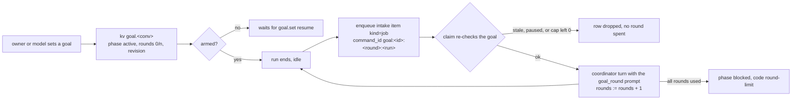

# 19 · Always-on: clock, compaction, loop guard, schedules and goals

This section decides what makes Ingle usable as an agent that runs unattended for hours: it knows what time it is, it can be compacted on demand, it is nudged out of a tool loop, it can schedule its own future work, and it can carry one objective across many rounds. Every mechanism here is a port of a named dsh package. Nothing is invented (owner rule 2026-11-07, and the owner's approval of this list on 2026-11-07).

Read with: [10 Time](./10-time.md) for the alarm the rounds share, [06 Orchestration](./06-orchestration.md) for the run a round continues, [04 Intake and dispatch](./04-intake-and-dispatch.md) for the batch a fire becomes, [11 Failures and cost](./11-failures-and-cost.md) for what each wake costs.

## Ambient clock (`time` row, dsh `context/time-context`)

The model is told the time, it does not have to ask. The `time` row installs one `GenerationTask.beforeRequest` hook that appends a user-role reading to the request it is preparing, when one is due.

```text
Time sampled while preparing turn 4, step 2: 2026-11-07T03:12:44+00:00[Europe/Berlin]
Owner time zone: Europe/Berlin. Interpret otherwise-unqualified dates and times in this zone.
Elapsed since the preceding step context: 1m 12s.
```

- **Due.** A reading is written whenever the previous one is at least `refreshIntervalMs` old, so step 1 of a turn and every later step are eligible. Default `600000`; `0` writes one before every request. This is dsh's rule.
- **Baselines.** Step 1 measures elapsed time from the last model-visible message, later steps from the previous reading in the same turn. A missing baseline renders `unavailable`, and a backward clock clamps to zero.
- **Zone.** `timeZone` config, default `UTC`, validated with `Intl.DateTimeFormat` at load so a bad zone fails the row instead of the request. dsh resolves the zone per request from the browser; Ingle's owner has one zone, so the row config is the only source.
- **Text format** is dsh's: ISO-shaped with a numeric offset and the IANA zone in brackets, then the zone instruction, then elapsed time in `1d 2h 3m 4s` units.
- **The reading is request-scoped, not a committed entry.** pi 1.5.0's `beforeRequest` replaces the messages of one request and exposes no commit, and dsh's durable reading is written by its own session log. So the reading reaches the model and nothing else: it is never in the transcript, the client never renders it, compaction never summarizes it, and the baseline after an eviction comes from the last real message. This is a logged deviation from dsh, not a design choice.
- **Counters.** pi exposes no turn or step number to a hook. A turn is a run of requests in this conversation instance that begins at a user message, and a step counts requests since then, with a request signature so a retried or recovered request does not advance either.
- **The `current_time` tool is removed.** dsh has no such tool; the reading replaces it. A model that needs a second opinion inside one step reads its own history.

## Manual compaction (`compact` row, dsh `command-compact`)

The owner can condense a conversation now instead of waiting for pi's threshold.

- Op `conv.compact { conversationId, instructions? }` calls `conversation.compact(instructions)`, the pi manual path that already exists.
- It answers `busy` while that conversation has a live run or task, which is dsh's rule (`/compact` reports unavailable mid-turn) and keeps the commit order obvious.
- An empty object is fine: `instructions` is a hint for the summarizer, exactly as in pi.
- There is no model tool for compaction. dsh gives `/compact` to the human only, and pi's automatic threshold (`compaction.reserveTokens`, `keepRecentTokens`, `backgroundTokens`, per-model overrides in `settings`) stays the model's path.

### Pruning and the utility summarizer (`beforeCompact`, dsh `compaction-tool-result-pruner`)

The same row installs one `beforeCompact` hook (`xin.compact`, `plugins/compact/summary.ts`) on pi's `CompactionTask`. pi runs it after choosing the cut and before its own summary request; a `{ summary }` it returns is placed as the compaction entry in one commit, and `undefined` lets pi summarize on the conversation's model as before. A hook cannot edit entries, so pruning is expressed as a summary: the replaced entries stay in the journal unchanged, and the context after the compaction is that summary plus the entries from `firstKept`.

1. **Prune only.** For `reason: "threshold"`, the hook serializes the replaced messages the way pi does (`[User]`, `[Assistant]`, `[Assistant tool calls]`, `[Tool result]`, system messages and thinking omitted), cutting every tool result longer than 2,000 chars to its first and last 1,000 chars around `[… N chars pruned …]`. If at least one result was cut and the text is at most 5,000 estimated tokens (pi-ai's 4 chars per token, a quarter of pi's default `keepRecentTokens`), that text is the summary. No model call. A later compaction folds the earlier pruned summary in like any summary, so repeated pruning grows only until it passes the budget, and then step 2 condenses it. `manual` and `overflow` compactions never take this path.
2. **Utility model.** Otherwise the hook resolves the owner's `utility` default (`resolveModel`, owner level only). With none, the same model as the conversation, a model missing from the catalog, a thrown call, or an answer that is not a clean text `stop`, it returns `undefined` and pi's summarizer runs. Otherwise it sends pi's summarization system prompt and prompt (mirrored, since pi 1.5 does not export them) over the pruned serialization, with `Additional focus: <instructions>` appended for a manual compaction, `cacheRetention: "none"`, `maxTokens` = min(80% of `reserveTokens`, the model's `maxTokens`), and the conversation's provider `sessionId`.

Cost: the prune path writes one journal commit (the summary) where pi's path writes two (the `summarize` checkpoint and the summary), reads nothing from SQLite, and spends no tokens; the pruned summary is carried in every later request until the next compaction, at most 5,000 tokens. The utility path reads the `owner.*` kv rows once and moves the summary request, the same bytes, from the chat model to the utility model. Every utility response, failed or not, is added to the conversation's `pi.usage` under `provider/modelId`, as pi records its own summary (pi 1.5 does not export `recordUsage`, so the hook mirrors it), so its tokens and cost reach `usage_daily`, the per-project spend and the monthly cap at the next usage flush. That is one immediate journal commit per utility response, before the placement commit, so the utility path writes two commits, as many as pi's own path (the `summarize` checkpoint and the summary with its usage).

## Loop guard (`guard` row, dsh `guard/repeat-tool-reminder`)

A model that calls the same tool with the same arguments is told to look again.

- `ToolTask.beforeTool` records `{name, arguments}` with object keys sorted; `ToolTask.afterTool` appends the reminder to that call's result when the repeat count reaches a threshold.
- Thresholds `[3, 5, 8]`. The third repeat gets one sentence, asking it to read the previous result and change approach or finish. The fifth and eighth also name the tool and a `argumentsPreviewChars`-capped preview of the arguments.
- Counts are per conversation and per exact `{name, arguments}`; a different call resets the count. A new owner message clears every count, so a fresh instruction is never treated as a loop.
- Advisory only: it never blocks the call, never delays it, and a legitimate repeat still runs. Config `{thresholds, include, exclude, argumentsPreviewChars}`; a threshold below 2, a duplicate, or an empty list fails the row at load.
- This is what covers an unattended coordinator turning in circles, which the watchdog cannot see: a looping run keeps beating, so it is never stalled.

## Automations (`automations`, `tool-automations`)

An automation is a stored prompt that starts an agent run when one of its triggers fires. It replaces the schedules plugin: one system for timed and event-driven work. The shape follows Capy's automations; the names are Ingle's.

**Storage.** Four plugin-owned SQLite tables, not pi documents, so history stays bounded and a fire costs a few rows instead of a journal flush: `automations`, `automation_triggers` (config JSON, the webhook secret, `next_at`), `automation_runs` (the last 50 per automation) and `automation_batches` (open coalescing groups).

**Triggers** (up to 20 per automation):

| Kind | Fields | Fires |
| --- | --- | --- |
| `schedule` | `cron` (five fields, lists, ranges, steps, month and weekday names), `tz` (IANA, default UTC) | at each wall-clock minute the expression names in `tz`; a minute daylight saving removes is skipped |
| `once` | `at` (ISO) | once, then its `next_at` clears |
| `webhook` | `contains?` (any of), `regex?`, `rules?` | on `POST /hooks/<secret>` |

**Timer.** Every deadline rides the one DO alarm through a `clock.timer`. `due()` answers the earliest `next_at`, the earliest batch `close_at`, or now while a run waits to start; one statement computes it and the answer is cached until a mutation, so other alarms pay nothing. A disabled automation's triggers carry no `next_at`, and webhook triggers never do, so a home with only those arms nothing. After downtime a schedule starts one run for the missed slot and moves on to the next future one.

**Webhook ingress.** The Worker forwards `/hooks/*` to the Home without a token check: the 43-character secret in the path is the only credential. One delivery is one Worker request and one DO request, capped at 64 KiB. `idempotency-key` (or `x-github-delivery`) makes a resend a no-op. Answers: 404 unknown secret, 413 too large, 200 `{status:"ignored", reason}` when disabled or the conditions miss, 202 `{status:"started", run}` or `{status:"batched", count}`.

**Coalescing.** Rules are ordered; the first whose `when` (field path → expected string) matches takes the delivery, and `groupBy` field paths pick its group. A group closes on `count`, `maxWaitSeconds` after its first input, or `quietSeconds` after its last, whichever comes first (24 h when none is set), and at 50 inputs. Closing starts one run with every input as a numbered `<webhook>` block. A delivery that matches no rule runs on its own.

**Where a run goes.** `fresh` (default) runs `thread.create` in the automation's project for every run. `same` reuses one conversation: the one named, the calling agent's own, or a thread created at the first run and kept. A thread receives the run through `thread.send` (queued); a coordinator receives it through intake as a `job` item, and that run ends as `delivered`. Every start uses the command id `automation:<run id>`, so a replay after a crash reuses the receipt.

**History.** A run moves `queued` → `running` → `completed | failed | cancelled` on `thread/settled`, or ends as `delivered`. Its cost and tokens are the thread's `pi.usage` at settle minus the value when it started.

**Tools.** `automation_save` (create without `id`; with `id` it updates, and takes `enabled` and `delete`), `automation_list`, `automation_trigger`. Create and update are one tool so the trigger schema is declared once per request, with one prompt section: only create, change or trigger automations at the user's explicit request. Ops and stream events are in `handoffs/api/automations.md` of the crew drive and in the verify skill's `features/automations.md`.

**Retired.** pi tasks of kind `xin.schedule` left by the old plugin end at their next wake through a version-3 tombstone definition. Old `xin.schedules` records are not converted; RRULE has no exact cron equivalent.

## Goals (`goals`, `tool-goals`, `goal-rounds`, dsh `goal`, `tool-goal`, `goal-round-driver`)

One durable objective per conversation, and an automatic round that keeps it moving while the coordinator is idle.



**State.** One goal per conversation in `kv` under `goal.<conversation>`, owned by the `goals` row.

```ts
type Goal = {
  readonly id: string                 // "g" + 12 hex
  readonly revision: number           // ++ on every accepted change
  readonly objective: string
  readonly phase: "active" | "paused" | "blocked" | "complete"
  readonly rounds: number
  readonly maxRounds: number
  readonly blocker?: { readonly code: string; readonly reason: string }
  readonly createdAt: number
  readonly updatedAt: number
}
```

- **Armed is instance-local.** The service keeps a `Set<conversation>` in memory, emptied when the row starts. An eviction, a deploy or a restart therefore leaves an active goal disarmed, exactly as dsh's process-local activation does, and nothing continues on its own until a human or the model resumes it. Durability of `armed` would let a crash loop keep spending rounds.
- **Compare-and-set.** Every change carries `{ id, revision }` from a read. A stale pair answers `stale_revision` with the current goal; nothing is overwritten silently.
- **Phases.** `pause` disarms and keeps state. `resume` re-arms an active or paused goal while rounds remain, and clears any blocker. `complete` ends it. `blocked` needs a non-empty reason and records `model-reported` (the model's own verdict, dsh's stable code) or `round-limit` (the driver's). `clear` removes it; a completed or cleared goal can be replaced, an unfinished one must be paused, blocked, completed or cleared first.

**Ops.** `goal.get { conversation }` and `goal.set { conversation, action, … }` where `action` is `create | edit | pause | resume | complete | block | clear`. One op with a discriminated action keeps the wire small; dsh's verb table is the same list.

**Tools** (dsh `tool-goal`): `get_goal()`, `create_goal(objective, max_goal_rounds?)`, `update_goal(goal_id, revision, action, objective?, max_goal_rounds?, blocked_reason?)`. All three answer the same compact JSON, `{ goal: null }` or `{ goal: { id, revision, objective, phase, roundsStarted, maxGoalRounds, blockedReason? }, activation }`. `activation` is a live observation. The tool row carries dsh's policy paragraph, including "mark blocked only after the same blocking condition persists for at least 3 consecutive goal rounds".

**The round driver** (`goal-rounds` row). It has no config and no service key, and disabling it leaves goals usable by hand.

- **Reserve, then admit.** A `GenerationTask.afterRun` hook fires once a run ends. With a live unarmed-free goal, `phase: active`, `armed`, and `rounds < maxRounds`, the driver enqueues one intake item `{ kind: "job", command_id: "goal:<goalId>:<round>:<run>" }` through `intake`, where `<run>` is the run's last entry id. The trailing id makes a reservation unique per run, so a dropped reservation never blocks the next one, and a replayed run reuses the same id. Nothing is counted yet.
- **Admission re-checks.** The batch is claimed when the alarm fires and the conversation is idle. The claim recomputes `armed`, `phase` and the remaining rounds from `kv`, and drops the row when any changed, so a pause, a completion or a human message in between costs no round. This is dsh's stale-reservation rule.
- **Admission spends one round.** The round is committed together with the claim, before the turn starts, so a crash after that point does not spend the round twice.
- **Cap.** When the last round is admitted, or a reservation finds `rounds === maxRounds`, the phase becomes `blocked` with code `round-limit`. Default cap `256`, overridable per goal; dsh's default.
- **Yielding to humans.** A pending goal row is deleted when an owner message for that conversation arrives, so the human's turn does not queue behind a round. A run started by a human does not reserve a round while it runs.
- **The prompt** is dsh's, verbatim: `<goal_round>` with the JSON-quoted objective, `Round: n/max`, and the instruction to treat workspace, tool results and durable state as authoritative, to gather evidence before completing, and to leave the goal active when work remains.

A goal is a property of a conversation, not a project. The coordinator of a project holds the goals for the work it drives; a thread that needs one uses `thread_send` and the coordinator's goal.

## Not added (deliberate)

- **No notifications classifier and no inbox priority.** Ingle has no noisy external source yet. The 2 s / 8 s debounce already batches bursts, and the classifier waits until a plugin produces more noise than turns can absorb.
- **No agent-owned `foldContext` / `dropContext`.** dsh keeps compaction in a threshold policy the model cannot drive, and pi implements it; model-driven context surgery is a larger failure surface for a saving pi's background compaction already gets.
- **No feedback store feeding the model.** dsh's `message-feedback` is log-only by design. If Ingle wants "when did acting pay off" memory, it belongs in the Dreamer's notes over the transcript it already reads, not in a ratings table.
- **No browser, no page cache.** The 2026-11-07 "no web row yet" decision is superseded: `tool-web` ships in `ingle-plugin-web` as an enabled row ([15 Web](./15-web.md)) that fetches a page as text and, once a Brave Search key is set, searches the public web. It renders no JavaScript, keeps no cache and has one search provider.
