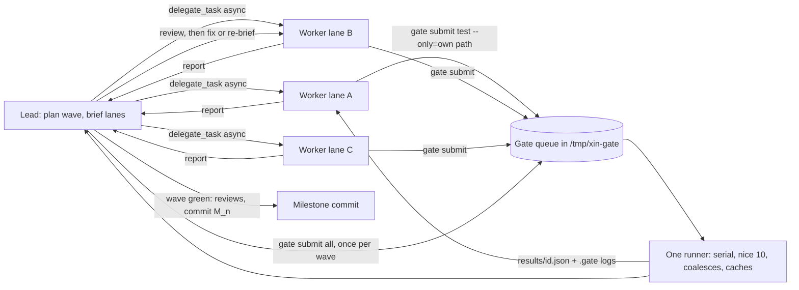

# Orchestration: how Xin gets built in parallel

There are two roles. The **lead** is the orchestrating session (Claude Opus): it plans waves, writes briefs, spawns workers, reviews, iterates, runs the full gate, and commits. **Workers** are subagents that implement exactly one lane each. Heavy jobs (format, lint, typecheck, tests, bundle) never run inside a worker. They go through one background queue.



## Workers

- **Model**: always `delegate_task` with `target: { providerInstanceId: "magpie", model: "group/workhorse[1m]" }` (Workhorse routing group, magpie, Claude Code driver). Leave the options at their defaults.
- **Isolation, which is the disk rule**:
  - Default is `isolation: "shared"`: lanes work in the lead's checkout and own disjoint files, as listed in the brief. This costs no disk.
  - Use `isolation: "worktree"` only when two lanes must touch the same file. Never run more than 4 worktrees at once, and only when `bun scripts/gate.ts status` reports more than 15 GB free.
  - A worktree needs its own `bun install`. Bun hardlinks from its global cache, so the cost is small but not zero. The lead removes the worktree (`git worktree remove`) as soon as its lane is merged.
- **Concurrency**: at most 24 live workers. Workers are I/O-bound (model calls), and the gate runner is the only CPU-heavy process, one job at a time.
- **Gate use**: a worker may `gate submit lint types test --only=<its test path>` followed by `gate wait <id>`, at most 3 times per lane. Nothing else. No `bun install` in the shared checkout (only the lead installs dependencies), no `wrangler dev`, no full gate.
- **A worker never commits** in the shared checkout. In a worktree it commits on its own branch, and the lead merges it.
- **Report contract**: the worker's final message ends with:
  ```
  LANE <id> · status: done|blocked
  changed: <file list>
  proof: <test file> · gate job <id> <ok|FAIL>
  decisions: <one line each, or none>
  ```

## The lead's loop

```text
for each wave in docs/plan/goal.md:
  1. write docs/log/waves/W<n>.md: lane table (id, spec sections, owned files, must-not-touch, proof test, isolation)
  2. install any new deps once (lead only), then gate submit types to set the baseline
  3. spawn every lane of the wave (async, ≤24 live), each with a brief from docs/process/brief-template.md
  4. as each report lands:
       read the diff · check it against the spec section · read its gate result
       small fix → lead fixes it directly
       real problem → new delegate_task for the same lane with: the original brief + findings + objections
  5. all lanes in: gate submit all → wait (background) → fix until green
  6. /pstack:thermo-nuclear-code-quality-review and /pstack:no-comments on the wave diff → fix
  7. /pstack:maintain-verification-skill (from M1 on) → drive the new behaviour once
  8. decisions.tsv rows · commit "M<n>: …" · remove merged worktrees
```

- The lead runs long waits (`gate wait`, worker results) in the background, never sleeping in the foreground, and reviews other lanes meanwhile.
- **Stuck lane**: no report after a reasonable time, or the same failure twice. Cancel it (`task_cancel`), split it smaller or re-brief it, and log the choice.
- **Spec conflicts** found by a worker come back as `blocked` with the question. The lead decides, updates `docs/plan/`, logs the decision, and re-briefs.

## Lane sizing

A lane is one module plus its test, roughly 100–400 lines of change, with one proof test that the gate can run with `--only`. If the brief needs more than one spec section to explain, split the lane. Shared types (`src/ids.ts`, `src/wire.ts`) are written by the lead before a wave starts, so lanes import them rather than inventing their own.
