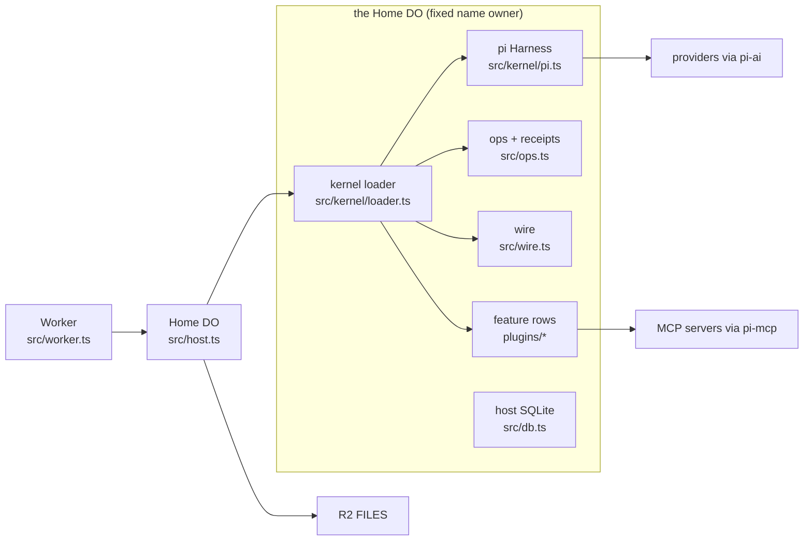
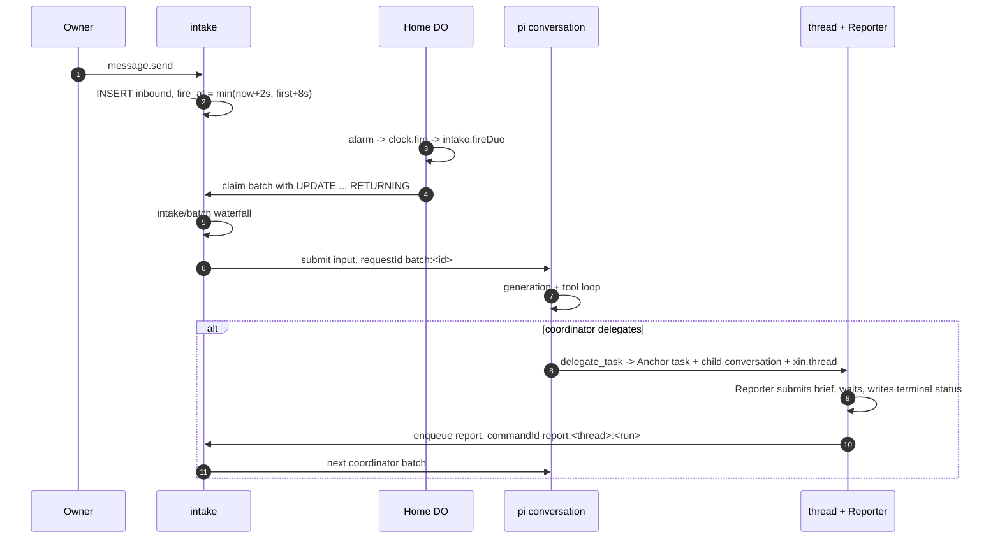

# Xin backend and agentic capabilities — current state

**Date:** 2026-11-09
**Tree:** `a5d4716` (this checkout is shallow; the history available here is one commit)
**Scope:** backend and agentic behaviour only. The web client is out of scope.
**Method:** read the source, contracts, migrations, tests and `docs/plan/`. The current-state pass was code-only; the follow-up isolation fix and the web slice installed dependencies and ran the repo gate. `fmt`, `lint`, `types`, `test` and `bundle` all pass. The full test run is 64 files passed, 1 skipped; 439 tests passed, 15 skipped. Statements about behaviour cite the code that implements it. Where the spec and code disagree, the disagreement is called out in [Spec vs code](#spec-vs-code).

Status legend:

- **Solid** — implemented end to end, with the failure paths handled and tests in the tree.
- **Works, gaps** — implemented, but a spec'd edge, isolation rule or operational property is missing.
- **Partial** — a mechanism exists, but only a narrow slice is wired.
- **Absent** — no implementation in this tree.

## Verdict

- The core is real and coherent. One Home Durable Object (addressed by the fixed name `owner`), a pi-durable Harness over SQLite, a shared op/receipt layer, intake batching, coordinator/thread orchestration, jobs, schedules, memory and a layered plugin loader all exist and fit together.
- The strongest design decision is the storage split: anything that must commit with a transcript is a pi document; everything outside pi's commit is a host table written through the same operation queue. The derived idempotency keys make replay the default recovery strategy rather than an afterthought.
- The weakest area for the stated goal was isolation and policy. The three isolation gaps that mattered most are now closed: a thread's file access is project-scoped, a child cannot read its siblings, and an agent can change the model only of itself or a thread in its own project. No approval gate, permission gate, sandbox or click-through was added.
- The plugin ecosystem is architecturally ahead of its surface. Rows, bundles, runtime bundles, market and an install pipeline exist, but there is no sandbox, no prompt/skill contribution row, no signature check, and code still requires a build and deploy.
- Agentic breadth is still narrow, but the first missing capability is now real: `web_search` and `web_fetch` read the public web through the job wrapper. There is no code execution, browser or git. MCP is tools-only. The deliberate "no code execution" rule is implemented, not merely documented.

## System shape and entry points



| Layer | Entry point | What it does |
| --- | --- | --- |
| Worker auth and forwarding | `src/worker.ts` | Accepts the deploy `OWNER_TOKEN` or a token whose SHA-256 the Home stored, handles `PUT /files/*`, forwards everything else to the Home. |
| Home lifecycle | `src/host.ts:20`, `src/host.ts:60` | Constructor runs inside `blockConcurrencyWhile`: sets a fallback alarm, boots the loader, opens the Harness, resumes it. |
| Alarm loop | `src/host.ts:88`, `src/kernel/clock.ts` | Folds heartbeat, pi wake and plugin timers into one alarm; `fire()` runs every timer. |
| Kernel composition | `src/kernel/loader.ts:261` | `boot()` creates the root Cordis context, reads the owner patch and runtime bundles, mounts rows, reports `boot_failed` if a required row is not active. |
| pi row | `src/kernel/pi.ts:37` | Opens `Harness.open` over `pi_`-prefixed DO SQLite, provides `ctx.harness`, installs extensions through `ctx.pi.install`. |
| Commands | `src/ops.ts:79` | `Commands.run` checks the receipt, the actor ceiling, invokes the op, stores the outcome. Failed ops store no receipt. |
| Wire | `src/wire.ts:92`, `src/kernel/wire.ts` | One socket per tab, hibernation-safe subscriptions, snapshots, deltas, `history.page`, `session.*`, `POST /v1/cmd`, `POST /v1/auth`, `GET /v1/socket`. |
| Features | `plugins/<name>/` | Native Cordis plugins. `src/catalog.ts` holds only the required kernel rows; `src/catalog.gen.ts` is generated from package manifests. |
| Profile | `xin.profile.json` | Names the bundles that compose the tree; the owner patch is stored in `kv` `plugins.patch`. |

## How a run executes



1. **Ingress.** `message.send` (`plugins/intake/index.ts:38`) resolves the target conversation (root when `conv` is omitted), enforces the monthly cap, and calls `enqueue` (`plugins/intake/gateway.ts:95`). The row is `INSERT OR IGNORE` on `command_id`, so a retried command cannot double-post.
2. **Debounce.** `fire_at` is `min(now + 2s, first + 8s)`. A `typing` frame extends the 2 s window but never past the 8 s window (`plugins/intake/gateway.ts:214`).
3. **Claim.** The alarm calls `clock.fire`; the intake timer calls `fireDue`, which claims every pending row for a target with one `UPDATE ... RETURNING` (`plugins/intake/gateway.ts:237`). A claimed batch is a `BatchId`.
4. **Batch policy.** `intake/batch` is a waterfall. The goal-round driver listens to it; a listener may rewrite a row or drop the batch (`plugins/goals/rounds.ts:81`). The rewritten rows are persisted before submit, so a crash replay resubmits the stored text.
5. **Dispatch.** `dispatchBatch` (`plugins/intake/gateway.ts:275`) reads `pi.live` and picks `start`, `steer`, `restart` or `stop` deterministically (`plugins/intake/dispatch.ts`). A non-user batch never restarts. `stop` aborts, marks claimed rows done and writes a `xin.notice`.
6. **Submit.** `submit` (`plugins/intake/gateway.ts:363`) renders user items as `<msg t="...">`, reports as `<thread id title status>`, appends an `<attachments>` block sized from the file index, inlines images within a 1 MiB budget when the model sees images, and stores a `xin.batch` entry. The request id is `batch:<batchId>`.
7. **Turn.** pi-durable runs the generation and tool loop. Plugin hooks run around it: time injects a request-scoped reading, guard counts repeated tool calls, watchdog beats, files scope blocks writes, redaction scrubs tool output.
8. **Thread.** `delegate_task` (`plugins/orchestrator/tools.ts:120`) calls `threads.delegate` (`plugins/orchestrator/service.ts:228`), which commits an Anchor task, a child conversation owned by that task, a `xin.thread` document and the workspace's `threadIds` in one transaction (`plugins/orchestrator/threads.ts:433`). The Reporter task (`plugins/orchestrator/threads.ts:107`) submits the brief, waits for the child's submission, writes the terminal status and result in one commit, then enqueues a `report` inbound row. A report is batched like any other input, so eight threads finishing together cost one coordinator turn.
9. **Other work.** Jobs (`plugins/jobs/jobs.ts`), schedules (`plugins/schedules/schedules.ts`), goal rounds (`plugins/goals/rounds.ts`), the Dreamer (`plugins/memory/dreamer.ts`) and the watchdog (`plugins/watchdog/watchdog.ts`) are pi tasks. Every plugin timer — the debounce, the file sweep, the Dreamer, the watchdog, the usage flush and held push — registers with `clock.timer`; `clock.arm` folds them into one alarm.

## Where state lives

| State | Kind | Shape / key | Owner |
| --- | --- | --- | --- |
| pi tables | pi SQLite, prefix `pi_` | conversations, entries, tasks, docs, usage | pi-durable; never touched directly (`src/kernel/pi.ts:37`) |
| `xin.workspace` | pi document, session scope | `{projects: {id: {slug,name,goal,preset,coordinatorId,threadIds,settings,archived}}}` | workspace (`src/contracts/workspace.ts`) |
| `xin.thread` | pi document, conversation scope | `{projectId,parentId,anchorTaskId,title,role,status,run,statusLine,beatAt,deadlineAt,result,clientRequestId}` | orchestrator (`src/contracts/threaddoc.ts`) |
| `xin.requests` | pi document, conversation scope | `{open, answered}` | questions (`src/contracts/questions.ts`) |
| `xin.jobs` | pi document, session scope | `{jobs, calls}` | jobs (`src/contracts/jobs.ts`) |
| `xin.schedules` | pi document, session scope | `{records}` with cursor, runs and delivery metadata | schedules (`plugins/schedules/schedules.ts`) |
| `inbound` | host table | pending/claimed/done rows, `command_id UNIQUE`, `fire_at`, `batch_id` | intake (`src/db.ts:3`) |
| `receipts` | host table | `command_id PK`, outcome JSON, pruned at 24 h | kernel (`src/ops.ts`) |
| `notes` + `notes_fts` | host table + FTS5 | notes, scopes, retirement, pin, dirty flag | memory (`src/db.ts:3`) |
| `kv` | host table | profile, cursors, owner settings, prompts, named credentials, patches, pending packages, usage watermarks, market policy | kernel and features by key |
| `files` + `file_revisions` | host tables | path → R2 key, size, type, sha256, project; last five revisions | files (`src/r2env.ts`) |
| `credentials` | host table | sealed provider credential JSON | models (`plugins/models/models.ts:354`) |
| `usage_daily` | host table | UTC day → spend, tokens | models |
| `market_history` | host table | package, version, at | market |
| `presets` | host table | conversation → preset id | presets |
| `push_subs` | host table | endpoint, keys | push |
| `market_indexes` | host table | cached index document and expiry | market |

Two credential namespaces exist and are easy to confuse:

- **Model provider credentials** live in the `credentials` table, sealed with `KEK`, behind pi-ai's `CredentialStore` (`plugins/models/models.ts:354`).
- **Named credentials** used by `${credential:REF}` templates live in `kv` under `secret.*`, sealed with the same `KEK` (`src/kernel/sealed.ts`, `src/kernel/secrets.ts`).

The `plugins` host table created by migration 2 is not read or written anywhere in the current tree. The live plugin state is the loader tree plus `kv` `plugins.patch` / `plugins.bundles` / `plugins.packages`.

## Capability table

| # | Capability | What exists | Entry point | Status |
| --- | --- | --- | --- | --- |
| 1 | Home DO | One SQLite-backed DO for the deployment, reached through `idFromName("owner")`; R2 for bytes; alarms for wake. | `src/host.ts`, `src/worker.ts`, `wrangler.jsonc` | Solid, single-tenant |
| 2 | Crash/eviction recovery | Fallback alarm, heartbeat while active, `harness.closed` → `ctx.abort`, replay-safe submissions. | `src/host.ts:60`, `src/host.test.ts` | Solid |
| 3 | Op layer and receipts | Every mutation is an op with a schema, actor ceiling, receipt and `ops/before` waterfall. | `src/ops.ts:79`, `src/kernel/ops.ts` | Solid |
| 4 | Wire protocol | Socket frames, snapshots, deltas, `history.page`, `session.list/close/rotate`, HTTP command route. | `src/wire.ts:92`, `src/kernel/wire.ts` | Solid |
| 5 | Intake and dispatch | Debounce, claim, batch, `start/steer/restart/stop`, crash replay. | `plugins/intake/*` | Solid |
| 6 | Models | Runtime catalog, per-conversation model and thinking level, mid-run switch, custom OpenAI-compatible endpoints, sealed API keys. | `plugins/models/models.ts:705` | Works, gaps |
| 7 | Usage and cap | pi ledger flushed into UTC days, month/today totals, per-model/tool/project slices, monthly cap, daily alert, push on thresholds. | `plugins/models/models.ts:856` | Works, gaps |
| 8 | Projects and coordinators | Project create/update/archive, ownerless coordinator conversation, workspace projection, owner instructions section. | `plugins/workspace/workspace.ts` | Solid |
| 9 | Threads | Delegate, Anchor task, child conversation, status machine, Reporter, reports, reopen, stop, status/cancel/send/read/list tools. | `plugins/orchestrator/*`, `src/contracts/threaddoc.ts` | Solid |
| 10 | Jobs | A slow tool runs as a pi task, waits 8 s inline, detaches and reports once; replay reuses the job; cancel by job id. | `plugins/jobs/jobs.ts:57` | Works, two callers |
| 11 | Questions | `ask_user` ends the turn, `pending_request` lists/reads/responds, owner `request.respond`, open-request list. | `plugins/questions/*` | Solid |
| 12 | Watchdog | 30 s task; stalled at 120 s without a job wrapper, or past the project deadline; writes `failed`, reports, aborts. | `plugins/watchdog/watchdog.ts` | Solid |
| 13 | Files | R2-backed `ExecutionEnv` for pi `read/write/edit`, content-addressed blobs, five revisions, upload bypass, orphan sweep; a thread is confined to its own project. | `plugins/files/files.ts`, `src/r2env.ts` | Solid |
| 14 | Memory | Append-only notes with FTS5, Dreamer as sole profile writer, owner add/edit/pin/forget, suggestions, profile section, `remember`/`recall`. | `plugins/memory/*` | Solid |
| 15 | Skills | Markdown frontmatter skills in `kv`, a skills section and a `skill` loader tool, owner `skill.put/delete/list/read`. | `plugins/skills/*` | Partial |
| 16 | MCP | Streamable HTTP client, stored servers, sealed headers, deferred tools through `tool_search`, row contribution, refresh. | `plugins/mcp/mcp.ts:149` | Solid, narrow |
| 17 | Schedules | RRULE + DTSTART, timezone, `this_session/new_once/new`, pause/resume, conflict on `expectedUpdatedAt`, run outcomes, plain-word parse. | `plugins/schedules/schedules.ts:175` | Solid |
| 18 | Goals | One goal per conversation in `kv`, phases, compare-and-set revisions, instance-local armed set, round driver with cap and stale-reservation drop. | `plugins/goals/goals.ts:44`, `plugins/goals/rounds.ts` | Solid, deviation |
| 19 | Time | Request-scoped user-role reading with zone and elapsed time; no `current_time` tool. | `plugins/time/index.ts` | Solid, deviation |
| 20 | Compaction and loop guard | Owner `conv.compact`; repeat-tool reminders at 3/5/8; advisory only. | `plugins/compact/index.ts`, `plugins/guard/index.ts` | Solid |
| 21 | Push | VAPID Web Push, subscription storage, prefs, quiet hours with held delivery, test push. | `plugins/push/push.ts` | Solid |
| 22 | Failures | `xin.error` entry for coordinator run failures, retry op that re-enqueues the original batch. | `plugins/failures/failures.ts` | Solid |
| 23 | Plugin kernel | Cordis loader rows, bundles, profile patch, runtime bundles, owner patch, live reconfigure, failure isolation, `plugins/changed`. | `src/kernel/loader.ts`, `src/kernel/bundles.ts` | Solid |
| 24 | Plugin manager | List/catalog/tree/enable/configure ops; optional `plugin_manager` agent tool, off by default. | `src/kernel/manager.ts`, `src/kernel/managertool.ts` | Solid |
| 25 | Package install | Parse registry/git specs, record pending add/remove, boot reconcile, deployer seam, CLI `plugin add/sync/generate`. | `src/kernel/packages.ts`, `scripts/xin.ts` | Works, gaps |
| 26 | Market | Format-1 indexes, npm version documents, verified tarballs, install/update/skip/rollback, patch-level auto-update. | `plugins/market/market.ts:223` | Solid, no indexes configured |
| 27 | Presets | Named tool-row allowlists, per-conversation record, live definitions, blank-conversation selection, thread inheritance. | `plugins/presets/presets.ts:85` | Solid |
| 28 | Observability | `system.version`, `system.metrics`, `system.logs`, `GET /v1/status`; in-memory log ring. | `src/kernel/system.ts`, `src/kernel/logs.ts` | Partial |
| 29 | Security | Owner token + rotation, KEK sealing, named credentials, tool-output redaction, `/me` and project-scoped file access. | `src/kernel/secrets.ts`, `src/kernel/redaction.ts`, `src/worker.ts`, `plugins/files/files.ts` | Partial |
| 30 | Tests | 65 test files, about 11.6k lines, real Worker/DO with `vitest-pool-workers`, faux provider by default, live test opt-in. | `src/**/*.test.ts`, `plugins/**/*.test.ts`, `test/` | Solid in tree |
| 31 | Web | `web_search` over DuckDuckGo HTML and `web_fetch` over public http(s); both run as jobs and return text, never files. | `plugins/web/*` | Solid |

## Plugin and extension story

### What is genuinely good

- **Rows are the unit of composition.** A plugin is a Cordis plugin with `name`, `inject`, optional `Config`, and `apply(ctx)`. Every registration is an effect, so disabling or reconfiguring a row unwinds exactly what it added (`src/kernel/loader.ts`, `src/kernel/pi.ts:69`).
- **Layering is dsh-shaped.** Bundles first, then runtime bundles (rows then patches), then the profile patch, then the owner patch. The owner patch is recomputed as the minimal departure from the lower layers, so writing an inherited value back drops the override (`src/kernel/layers.ts`, `src/kernel/loader.ts`).
- **Failure isolation is real.** A failed required row puts Home in `boot_failed`; any other failed row is reported `failed` with its error and the rest keep running. A missing plugin is `missing` and not mounted (`src/kernel/loader.ts`, `src/kernel/kernel.test.ts`).
- **Live changes are real.** `plugin.configure` validates against the plugin's schemastery `Config`, updates the loader row, and the extension is replaced in place. `plugin.enable` disposes the row's effects. New code still needs a rebuild (`src/kernel/manager.ts`).
- **Bundle install is live.** `bundle.put` validates rows and configs, writes `plugins.bundles`, recomposes, and restores the previous bundle when an update has a failing row. A fresh install with a failing row stays installed and reports the failure (`src/kernel/bundles.ts`, `src/kernel/bundles.test.ts`).
- **Market verification is careful.** A bundle tarball is fetched with redirects refused, capped at 8 MiB compressed and 4 MiB unpacked, checked against `dist.integrity`, gunzipped, read as ustar, and only `package/package.json` is used. The mounted rows come from that verified file (`plugins/market/tarball.ts`, `plugins/market/market.ts:416`).
- **Boundaries are enforced.** `scripts/boundaries.ts` rejects plugin-to-plugin imports and SQL that names another feature's table, and checks that only a row module reads `ctx.<service>` and lists it in `inject`.

### Extension points that exist

| Point | Kind | Used by |
| --- | --- | --- |
| `ctx.pi.install(extension)` | pi extension: tools, hooks, tasks, prompt sections, docs | every feature and tool row |
| `ops/before` | Cordis waterfall over every op | presets (validate `project.create`), goal rounds (withdraw a pending round on owner message) |
| `intake/batch` | Cordis waterfall over a claimed batch | goal rounds (admit or drop a round) |
| `thread/settled` | Cordis emit after a terminal status | declared and emitted; **no production listener** |
| `wire/typing` | Cordis parallel | intake |
| `plugins/changed` | Cordis emit after a row change | presets |
| `credentials/updated` | Cordis emit after `secret.set` | `mcp-server` row reconnect |
| `mcp/changed` | Cordis emit when the MCP tool set changes | `tool-mcp` republish |
| pi hooks | `GenerationTask.beforeRequest/afterResponse`, `ToolTask.beforeTool/afterTool`, `GenerationTask.afterRun` | time, guard, watchdog, files scope, redaction, goal rounds |
| Services | `ctx.provide("<key>", value)` and `src/contracts/<key>.ts` | files, models, threads, jobs, intake, memory, questions, skills, schedules, mcp, watchdog, push, workspace |

`thread/settled` is the clearest unused seam. It is emitted at least once from the Reporter's replay-safe report phase (`plugins/orchestrator/threads.ts`, `plugins/orchestrator/index.ts`), but nothing in the tree subscribes to it. It is ready for a notification, audit or webhook plugin.

### Install and update paths

There are two kinds of package:

- **Bundle** — data only. Its `package.json` `xin` field declares `bundle` and no `plugins`. The Worker fetches the tarball, verifies it, stores it in `kv` `plugins.bundles`, and mounts the rows live. No deploy.
- **Code** — its `xin` field declares `plugins`. `plugin.install` records a pending spec in `kv` `plugins.packages`; `system.update` calls the `deployer` seam; `deploy-hook` POSTs the pending list to a configured hook; the pipeline runs `bun scripts/xin.ts plugin sync`, regenerates `src/catalog.gen.ts`, gates and deploys. The next boot reconciles the pending list.

`plugin.install` / `plugin.uninstall` / `plugin.packages` and `GET /v1/build/packages` live in `src/kernel/packages.ts`. The CLI lives in `scripts/xin.ts`. The workflow is documented in `docs/deploy/install-pipeline.md`, but that document still uses the removed op name `plugin.secret.set`; the current op is `secret.set` (`src/kernel/secrets.ts:25`).

### Trust model

In-process plugins run in the Home isolate with full access to the services they inject. Installing a package is the trust decision. There is no network allowlist, no capability manifest and no sandbox. The spec says this explicitly and points to Cloudflare's Worker Loader as the later isolation path on the paid plan (`docs/plan/architecture/09-plugins.md`, "Trust"). The code matches that: the loader mounts native modules from the build; it does not load third-party code at run time.

## Spec vs code

| Spec claim | Code today | Effect |
| --- | --- | --- |
| `set_model` supports `this_chat`, `thread:<id>`, `new_threads` and `project_default` (`05-models.md`) | `this_chat` and `thread:<id>` work; `new_threads` and `project_default` return "not available yet" (`plugins/models/tools.ts:22`) | The model can switch one chat or one thread, not a project's future threads. The message also says "it arrives with projects and threads", which is stale: projects and threads exist. |
| A thread writes only under `/projects/<its project>/` (`08-files.md`) | Implemented: `projectScoped` resolves the thread's project and allows only `/projects/<slug>/` for file ops and pi `write`/`edit`; `/me` stays coordinator-only (`plugins/files/files.ts`) | Thread writes and reads are confined to the project. |
| A child receives only its brief and role; nothing private leaks into a thread (`06-orchestration.md`) | Fixed: `delegate_task` removes `delegate_task`, `task_cancel`, `thread_send`, `thread_read`, `thread_list`, `task_status` and `pending_request` from the child; `threadInScope` lets a thread see only itself (`plugins/orchestrator/service.ts`, `src/contracts/threaddoc.ts`) | A child cannot read or list siblings. |
| A goal is a property of a conversation; a thread that needs one uses the coordinator's goal (`13-always-on.md`) | Goal tools and the round driver work on any conversation id, including a thread (`plugins/goals/tools.ts`, `plugins/goals/rounds.ts`) | A thread can create its own goal and self-continue, bypassing the coordinator. |
| Any `latency:"maybe-slow"` tool is wrapped with `wrapTool` (`06-orchestration.md`) | Jobs are wrapped by `jobTool`; only MCP tools call it (`plugins/mcp/mcp.ts:248`, `:321`) | There is no generic wrapper for future slow tools. A new web or research tool must call `jobs.tool` itself. |
| Subscription OAuth logins work (`05-models.md`) | The credential shape accepts an `oauth` object and `SealedCredentialStore.modify` serialises refresh, but `credential.set` only accepts an API key or a custom endpoint (`plugins/models/models.ts:766`) | There is no login flow or op that starts an OAuth exchange. |
| Plugin-manager mutations follow a `tools/pre-execute` and `user-approval` gate (P10, `09-plugins.md`) | No `tools/pre-execute` gate and no approval service exist in the tree; `plugin_manager` executes immediately (`src/kernel/managertool.ts`) | Any model that can call the tool can enable/configure rows without asking. |
| `thread/settled` is an extension point (`09-plugins.md`) | Emitted, but no production listener (`plugins/orchestrator/index.ts`) | The seam is ready but unused. |
| The Reporter is the single writer of a terminal status (`06-orchestration.md`) | The Reporter writes `completed`/`cancelled`/`failed` on a normal run, but the watchdog writes `failed` and the result itself before enqueuing the report (`plugins/watchdog/watchdog.ts` check phase); the Reporter then skips a thread that is no longer `working` | Two terminal writers on the failure path, contained by the status check. |
| The only timer Xin owns is the debounce (`10-time.md`) | `clock.timer` is also used by files (weekly sweep), memory (Dreamer), watchdog, models (usage flush) and push (held delivery) (`plugins/*/index.ts`) | The single-alarm rule holds, but there are several plugin timers, not one. |
| One Home Durable Object per owner (`README.md`, `01-host.md`) | The Worker always resolves `env.HOME.idFromName("owner")` (`src/worker.ts`) | One Home and one identity for the deployment. This is single-tenant, not one Home per owner. |
| The `plugins` table holds per-plugin sealed state (`02-state.md`) | Table exists from migration 2; nothing reads or writes it (`src/db.ts:10`) | Dead table; named credentials use `kv` `secret.*`. |

## Gaps that matter most

Ordered by what blocks the Space's three goals: a better backend/agentic experience, better capabilities, and a best-in-class plugin ecosystem.

> **Closed in this change (2026-11-09):** the three isolation gaps below are fixed. The regression tests are `confines a thread to its own project for writes and reads` and `blocks a thread's pi write outside its project` (`plugins/files/files.test.ts`), `confines an agent's model changes to itself or its own project's threads` (`plugins/models/models.test.ts`), and `lets a thread see itself but not its siblings` plus `does not offer a delegated thread its siblings or the coordinator's thread tools` (`plugins/orchestrator/orchestrator.test.ts`, `plugins/orchestrator/tools.test.ts`). The web slice is also in: `web_search` and `web_fetch` are built and tested (`plugins/web/web.test.ts`).

### P0 — isolation and policy (1–3 closed in this change)

1. **Fixed: thread file confinement.** `projectScoped` resolves the thread's project from `xin.thread` + `xin.workspace` and allows only `/projects/<its slug>/`; the same scope runs on `file.list`, `file.read`, `file.revision`, `file.revisions`, `file.put`, `file.delete` and pi `write`/`edit`. `/me` stays coordinator-only (`plugins/files/files.ts`).
2. **Fixed: sibling reads.** `delegate_task` now removes `thread_read`, `thread_list`, `task_status` and `pending_request` from the child as well as the old three, and `threadInScope` returns `undefined` when a thread caller names any thread but itself (`plugins/orchestrator/service.ts`, `src/contracts/threaddoc.ts`).
3. **Fixed: `conv.configure` scope.** An agent may configure itself, or a thread in its own project when it is that project's coordinator. A thread cannot reach its coordinator or a sibling, and a coordinator cannot reach another project (`plugins/models/models.ts`).
4. **No approval gate was added, by instruction.** This change is correctness only: no approval gates, permission gates, sandbox or click-through. `plugin_manager` mutations still execute immediately; P10 remains the spec for a future gate.
5. **`conv.stop` does not clear pending inbound.** `dispatchBatch` marks claimed rows done and aborts the run, but rows still `pending` for that target are left alone (`plugins/intake/gateway.ts:308`). A queued report or message can start a turn immediately after a stop. `message.withdraw` only deletes a pending row by command id.
6. **`set_model`'s project-level targets are absent.** `new_threads` and `project_default` are advertised in the tool description but return "not available yet" (`plugins/models/tools.ts:22`). The coordinator cannot set the model for future threads through the tool; the owner must use `project.update` or `owner.defaults`.
7. **Goals are not confined to coordinators.** The round driver and goal tools work on any conversation, including a thread (`plugins/goals/rounds.ts`). The spec says a thread should use the coordinator's goal. A thread with its own goal can consume rounds and spend tokens outside the coordinator's view.
8. **Stop-word handling is narrow.** Only the exact words `stop`, `wait`, `cancel`, `nvm` (case-insensitive, trimmed) count (`plugins/intake/dispatch.ts`). "stop it", "never mind" or a non-English equivalent steer instead of stopping.

### P1 — plugin ecosystem

9. **No sandbox for third-party code.** Code packages run in the Home isolate with full access to injected services. The free plan has no Worker Loader, so the only isolation story today is "make it an MCP server" (`docs/plan/architecture/09-plugins.md`, "Trust"). This caps what a market can safely offer.
10. **Code install still needs a build and deploy.** `plugin.install` records a wish; `system.update` dispatches a pipeline; the code arrives on the next build (`src/kernel/packages.ts`, `docs/deploy/install-pipeline.md`). Bundles mount live, but they are data only. A "best-in-class" ecosystem needs either a trusted review pipeline or a runtime sandbox.
11. **No prompt or skill contribution rows.** `skills.contribute` exists in the service (`src/contracts/skills.ts:19`) and `createSkills` builds a contribution set (`plugins/skills/skills.ts:83`), but no production row calls it. `BUNDLED_SKILLS` is empty (`plugins/skills/skills.ts:7`). The `prompt` and `skill` contribution rows were removed in P9; today a bundle can contribute an MCP server and a preset, not a skill or a slash prompt. This is the biggest missing piece for a plugin ecosystem that changes agent behaviour, not just tool access.
12. **Market discovery is empty by default.** `market.indexes` defaults to `[]` (`plugins/market/market.ts` config). `market.search` works only after the owner configures index URLs. There is no shipped index and no keyword search against npm (removed in P9). A new owner sees an empty market.
13. **No signature or author verification.** Tarballs are integrity-checked against the registry's `dist.integrity`, which proves the bytes match the registry document, not that the publisher is trusted. There is no signature, no publisher key and no allowlist.
14. **No dependency resolution.** A bundle can `require` code package specs, and those are recorded as pending installs. There is no version solver, no conflict detection between bundles and no check that a required package's rows satisfy the configs the bundle assumes.
15. **The plugin API has no version contract.** `engines.xin` is parsed by the market (`plugins/market/marketindex.ts`), but the loader does not enforce a plugin API version. The spec shows an authoring example; it does not define a compatibility boundary. A change to `src/contracts/*` or to a service interface breaks third-party code at boot with a row failure, not at install.
16. **No per-plugin quotas, telemetry or health.** A plugin can register unlimited tools, timers and ops. There is no per-row CPU, subrequest or storage budget, and no plugin-level metrics. `system.metrics` reports rows, storage and sockets, not per-plugin cost.
17. **`plugin_manager` is off by default and has no install action.** The tool row is disabled in `src/catalog.ts` (`tool-plugins`), and the tool exposes list/catalog/tree/enable/configure only (`src/kernel/managertool.ts`). The agent cannot install, uninstall or inspect the market.

### P1 — agentic depth

18. **Fixed: web search and page fetch.** `web_search` reads DuckDuckGo HTML and returns titles, URLs and snippets; `web_fetch` reads a public http(s) page and returns readable text, with loopback/private/link-local addresses, credentials and non-default ports refused. Both run through `jobs.tool` and write no files (`plugins/web/*`).
19. **No code execution, browser, git or VPS access.** `R2Env.exec()` returns `shell_unavailable` (`src/r2env.ts`), and there are no optional plugins for bash, a sandbox, a browser or git. This is deliberate in the spec and AGENTS, but it means the agent cannot run a build, inspect a repo or drive a page today.
20. **MCP is tools-only.** The client lists and calls tools; it does not expose resources, prompts, sampling or elicitation, and it opens no GET stream (`plugins/mcp/mcp.ts:139`). That is enough for tool connectors, not for the full MCP surface.
21. **Jobs have only two callers.** `jobTool` is a good primitive (`plugins/jobs/jobs.ts:57`), but only MCP (`plugins/mcp/mcp.ts`) and web (`plugins/web/index.ts`) call it. A new slow tool must remember to wrap itself; there is no registry-level `latency` declaration or automatic wrap.
22. **No agent-authored skills.** `skill.put` is owner-only (`plugins/skills/skills.ts:104`). The agent can load a skill but cannot create or edit one. Memory and files are the durable channels it can write; skills are owner-only.
23. **No project management tools.** `project.create` accepts an agent actor (`plugins/workspace/workspace.ts:233`), but no tool calls it. `project.update`, `project.archive` and `thread.rename` are owner-only. A coordinator cannot create, rename, archive or retune a project.
24. **No cross-conversation search.** `history.page` is per conversation; memory recall is scoped to `me` and the caller's project. There is no "find where we discussed X" across projects.
25. **No plan/todo or artifact tool.** There is no structured plan state, no todo list and no artifact primitive beyond writing a file. Long goals rely on the model's own narration and the transcript.

### P2 — reliability and operations

26. **The production subrequest cap is still unproven.** The M0 decision log records that local workerd does not enforce the production per-invocation cap; the 10×30 stress test passes locally. The spec flags this as a risk (`docs/plan/architecture/01-host.md`, "Runtime facts"). A long multi-thread wake could still trip it in production.
27. **Observability is thin.** `system.logs` is a module-global in-memory ring (`src/kernel/logs.ts:24`); it is lost on eviction and is not persisted. There are no traces, no per-run timing, no per-tool latency and no audit trail of who ran which op. Receipts keep the outcome, not the actor, and are pruned at 24 h.
28. **The cap check can overshoot.** `message.send` compares the month's spend from `usage_daily` (`plugins/intake/index.ts:44`), but `models.spend()` reads the dated table without flushing the live ledger first (`plugins/models/models.ts:904`). A burst can pass the door before the alarm flush records it.
29. **Table ownership is incomplete.** `src/kernel/dbtables.ts` lists `kv`, `receipts`, `plugins`, `inbound`, `credentials`, `files`, `notes`, `notes_fts`, `push_subs`, `presets`, `market_indexes` — but not `usage_daily`, `market_history` or `file_revisions`. `scripts/boundaries.ts` therefore cannot catch a plugin writing those tables. The `plugins` table itself is dead.
30. **No backup, export or retention policy.** Inbound rows are pruned at 7 days, receipts at 24 h; notes, files, transcripts and credentials persist indefinitely. There is no export, import or owner-facing backup.
31. **Single tenant per deployment.** The Home id is always `idFromName("owner")` (`src/worker.ts`). There is one identity, one token and one workspace. Multi-user or team use would need a different routing and auth model.
32. **No rate limiting or quotas.** Apart from the monthly spend cap and thread limits, there is no per-conversation rate limit, no tool-call quota and no backpressure on inbound.
33. **Docs drift.** `docs/deploy/install-pipeline.md` uses `plugin.secret.set` (removed; now `secret.set`). `plugins/models/tools.ts` says `new_threads`/`project_default` "arrive with projects and threads", which is stale. `06-orchestration.md` describes a generic `wrapTool` latency wrapper that is not used. `05-models.md` implies OAuth login works; the credential shape supports it but no login flow exists.

## Strong parts worth preserving

- **The alarm discipline.** `Home.#open` sets a fallback alarm before boot; `clock.arm` folds heartbeat, pi wake and plugin timers into one `setAlarm(min(...))`; `harness.closed` aborts so the next event reconstructs. `src/host.test.ts` asserts an evicted run answers exactly once.
- **Derived idempotency.** `batch:`, `delegate:`, `report:`, `thread-send:`, `error:`, `sched:`, `job:`, `question:`, `answer:` keys are computed, never random. A replay recomputes the same key and pi returns the existing submission.
- **The Reporter as the normal terminal writer.** `thread.stop` only aborts; on a normal run the Reporter writes `cancelled`/`completed`/`failed` and the result in one commit. The watchdog is the exception: it writes `failed` and the result itself, then enqueues the report, and the Reporter skips a thread that is no longer `working` (`plugins/watchdog/watchdog.ts`, `plugins/orchestrator/threads.ts`, decision log M5/M6).
- **Intake batching.** Eight finished threads become one coordinator turn; a burst of three messages becomes one turn; a question answered before its row is claimed deletes the row.
- **Jobs.** The wrapper's `calls` map makes a replayed tool call wait on the job it already created, and only a detached job posts a report. The thread variant waits inline until the thread deadline.
- **Schedules.** The record has a cursor, six retained runs and an `after` marker per run, so outcomes are resolved only when asked. `expectedUpdatedAt` gives a real conflict check.
- **The Dreamer.** One writer, a validated output contract, a size cap, a secret-leak check and an instruction-shape check; an invalid result retries once and leaves the cursor unchanged.
- **Bundle layering.** The owner patch is a minimal departure from lower layers, runtime bundle updates restore the previous version on failure, and a fresh install with a failing row stays installed and reports it.
- **Market tarball handling.** Redirects refused, byte caps, sha512 integrity, gunzip, ustar, only `package/package.json` trusted.
- **Test breadth.** 65 files and about 11.6k lines cover the host loop, ops, wire, intake, models, files, orchestrator, jobs, questions, watchdog, memory, schedules, goals, presets, MCP, market, web, plugin kernel and live runs. The live test is opt-in through `XIN_LIVE=1`.

## What I would do next

This is judgment, not a claim about the current state.

1. **Keep the isolation and web tests green.** The three isolation fixes and the two web tools are covered by regression tests; a future change that widens thread scope, child tools or the web URL policy should fail one of them.
2. **Make skills and prompts contributable rows.** That is the smallest change that turns bundles from "tool connectors" into "agent behaviour packages". The `skills.contribute` API already exists; it needs a `skill` row, a `prompt` row and tests.
3. **Ship a default market index and a trust story.** A read-only index with a few first-party bundles, plus a signature or publisher allowlist, would make the market usable on day one.

## How to re-check

The repo's gate is the intended path; do not run `tsc`, `vitest` or `wrangler` directly.

```bash
bun scripts/gate.ts submit fmt lint types test bundle
bun scripts/gate.ts wait <id>
bun scripts/gate.ts submit test --only=plugins/orchestrator   # one lane
XIN_LIVE=1 bun scripts/gate.ts submit test --only=src/live    # live models, local only
bun scripts/xin.ts plugin list                                # composed catalog
```

The live test reads `OPENCODE_API_KEY` from `.dev.vars` and picks the first answering model from `XIN_LIVE_MODELS`. It is skipped unless `XIN_LIVE=1`.

## Appendix — files and entry points read

Core: `src/host.ts`, `src/worker.ts`, `src/ops.ts`, `src/wire.ts`, `src/db.ts`, `src/env.ts`, `src/module.ts`, `src/catalog.ts`, `src/catalog.gen.ts`, `src/credentials.ts`, `src/r2env.ts`, `src/upload.ts`, `src/transcript.ts`, `src/contributions.ts`, `src/seal.ts`, `src/ids.ts`, `src/rowid.ts`, `src/serial.ts`.

Kernel: `src/kernel/loader.ts`, `pi.ts`, `ops.ts`, `clock.ts`, `wire.ts`, `http.ts`, `db.ts`, `dbtables.ts`, `secrets.ts`, `sealed.ts`, `redaction.ts`, `token.ts`, `manager.ts`, `managertool.ts`, `packages.ts`, `bundles.ts`, `bundlestore.ts`, `bundlepatch.ts`, `layers.ts`, `patch.ts`, `config.ts`, `system.ts`, `logs.ts`, `types.ts`.

Contracts: `src/contracts/workspace.ts`, `threaddoc.ts`, `threads.ts`, `intake.ts`, `message.ts`, `models.ts`, `files.ts`, `memory.ts`, `questions.ts`, `jobs.ts`, `schedules.ts`, `goals.ts`, `presets.ts`, `skills.ts`, `mcp.ts`, `push.ts`, `watchdog.ts`.

Features: `plugins/intake/*`, `plugins/orchestrator/*`, `plugins/workspace/*`, `plugins/models/*`, `plugins/files/*`, `plugins/memory/*`, `plugins/skills/*`, `plugins/mcp/*`, `plugins/schedules/*`, `plugins/goals/*`, `plugins/questions/*`, `plugins/jobs/*`, `plugins/watchdog/*`, `plugins/presets/*`, `plugins/market/*`, `plugins/push/*`, `plugins/failures/*`, `plugins/compact/*`, `plugins/guard/*`, `plugins/time/*`, `plugins/deploy-hook/*`.

Build and test: `package.json`, `wrangler.jsonc`, `wrangler.free.jsonc`, `xin.profile.json`, `vitest.config.ts`, `scripts/boundaries.ts`, `scripts/xin.ts`, `test/worker.ts`, `test/kernel.ts`, `test/support.ts`, `test/live.ts`, `src/host.test.ts`, `src/ops.test.ts`, `src/cost.test.ts`, `src/live.test.ts`, `src/kernel/*.test.ts`, `plugins/**/*.test.ts`.

Spec and logs: `docs/plan/README.md`, `docs/plan/goal.md`, `docs/plan/milestones.md`, `docs/plan/architecture/01-host.md` through `14-client.md` (excluding client details), `docs/log/decisions.tsv`, `docs/log/waves/W3.md`, `docs/deploy/install-pipeline.md`.
